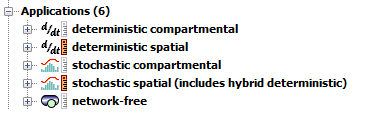
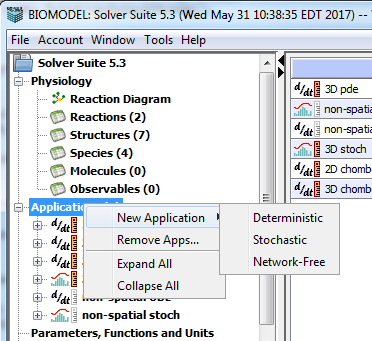

# Applications Overview

Applications allow users to specify the quantitative conditions needed to define, run and visualize
a Virtual Experiment, i.e. a numerical simulation of the BioModel with specific initial conditions,
within a given geometry, and with a selected type of simulation method. In the Application,

- the mapping between the model and the geometry is established in the
  [Geometry](Geometry/GeometryOverview.md) tab
- [Specifications](Specifications/SpecificationsOverview.md) for species, reactions and network (for
  rule-based application) are defined,
- specific [Protocols](Protocols/ProtocolsOverview.md) (events, electric stimulation) can be
  included,
- for each application, multiple [Simulations](Simulations/simulations_overview.md) can be created
  that can include different initial conditions.
- [Parameter Estimation](ParameterEstimation/PEOverview.md) can be performed.

Applications can be

- [Deterministic](../Appendix/Definitions.md#deterministic)
- [Stochastic](../Appendix/Definitions.md#stochastic)
- [Hybrid Deterministic Stochastic](../Appendix/Definitions.md#hybrid-deterministic-stochastic), a
  stochastic model with at least 1 species specification set to 'Force Continuous' (See **Spatial
  Stochastic** or **Non-Spatial Stochastic** under
  [Species Specifications](Specifications/SpeciesSpecifications.md)).
- [Network-free](../Appendix/Definitions.md#rule-based), a special stochastic
  [network-free application](../RuleBasedChapter/NFSimApp.md) that does not require generating a
  network to simulate.

Additionally, by defining [Geometry](Geometry/GeometryOverview.md), deterministic, stochastic or
network-free applications can be made:

- **Compartmental** (1D, 2D or 3D), where the topology and size of compartments are defined, but
  species are assumed to be well mixed within their compartments. A compartmental application is
  simulated using either differential equations (for
  [deterministic](../Appendix/Definitions.md#deterministic) application), or using stochastic
  simulation algorithms (for [stochastic](../Appendix/Definitions.md#stochastic) application).
- **Spatial** (1D, 2D or 3D), where the geometry of compartments is defined, and species diffuse
  within compartments. A spatial application is simulated using either partial differential
  equations (for [deterministic](../Appendix/Definitions.md#deterministic) applications), or using
  the stochastic agent-based simulation algorithm SmolDyn (for
  [stochastic](../Appendix/Definitions.md#stochastic) applications). Deterministic spatial
  applications can also utilize our moving boundary solver in cases where movement of volumes or
  surfaces can be described within the simulation. Presently
  [Network-free](../Appendix/Definitions.md#rule-based) applications do not allow spatial geometry
  (compartmental only).

The Application directory displays the Applications associated with the BioModel. The main window
displays the selected application and provides buttons to create new applications or to delete or
copy applications. Properties for a selected object (e.g. species, reaction, simulation) are
displayed in the Properties Pane below the main window.

**Create** a new application by selecting "Applications" in the left menu. Right click opens a menu
to create a deterministic, stochastic, or network-free application. Or, use the **New Application**
button in the main window.

**View/Edit** application components and properties by double-clicking, or selecting the + icon
beside, the 'Applications' tree in the navigation panel to expose the names of applications
contained in the BioModel; select one of the Application names to activate the 'view' and
'properties' panels that display all the application detail editors.

