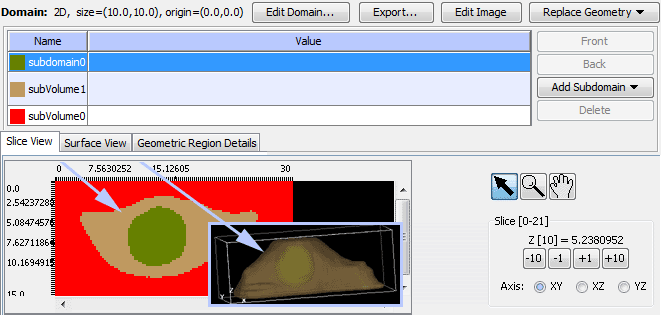

# Geometry Overview

There are 2 types of geometries in VCell, **spatial** and **non-spatial**:

- Non-spatial geometries (0 dimensional and not spatially resolved) are implicitly defined in
  non-spatial applications (for ODE and non-spatial stochastic simulations).
- Spatial geometries (1,2,3 dimensional and spatially resolved) must be explicitly defined by the
  user in spatial applications (for PDE and spatial stochastic simulations).

Using the **Geometry Definition Tab** Spatial geometries can be defined in several ways:

- Re-using previously defined geometries from other VCell model applications (including shared
  models from other users).
- Creating new geometries by defining analytic equations that describe compartment distributions in
  space. ([Analytic Geometry](geom_Analytic.md))
- Creating new geometries by manually defining compartments on a regular grid of points in space
  (image painting). ([Image Geometry](geom_from_images.md))
- Creating new geometries by importing pre-segmented image files defining compartments as areas of
  different pixel values. ([Image Geometry](geom_from_images.md))
- Creating new geometries by importing image files as templates and performing image processing
  functions to define compartments. ([Image Geometry](geom_from_images.md))
- Creating new geometries by importing surface mesh files and sampling within a spatial domain to
  define compartments. ([Geometry from Surface](geom_from_surface.md))

Geometries can be viewed as:

- Individual image planes in the x,y,z dimension.
- Rendered surface boundaries between compartment regions.

[Kinematics](Kinematics.md) can be used to specify velocities of spatial objects in applications
that employing moving boundaries. The current moving boundary solver can be used for 2D geometries
only.

The Geometry domain (origin and extent) can be edited. The geometry can be exported in different
surface mesh formats by clicking the **Export...** button. Analytic geometries functions can be
edited in place by double-clicking the table cell containing the analytic expression. An analytic
geometry can be converted to an [Image Geometry](geom_from_images.md) by clicking the **Edit Image**
button. The currently defined geometry can be changed (replaced).

