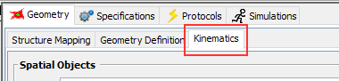
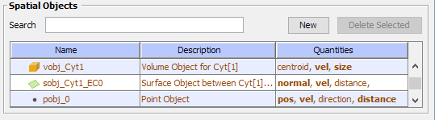
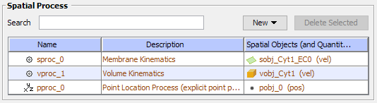

# Kinematics

Virtual Cell supports moving boundary applications for 2D geometries using a moving boundary solver.
Specifying a velocity field for objects using the **Kinematics** tab in the Geometry workspace
automatically invokes use of the moving boundary solver for simulations. Either a constant value or
a function can be used to describe the velocity of defined spatial objects within the simulation.

The kinematics tab in the geometry workspace displays two Tables.

The top **Spatial Objects Table** identifies the different spatial objects in the BioModel along
with the associated properties that can be used in kinematic expressions for each object.

- **Volume Objects** are defined by the BioModel structures and can use properties of **centroid,
  velocity and size**.
- **Surface Objects** are defined by the BioModel structures and can use properties of **unit
  normal, velocity, distance, direction, and size**.
- **Point Objects** are defined in the kinematics and can use properties of **position (x and y
  coordinates), velocity, direction, and distance**.

Each type of Object has a Properties Pane that allows the user to select the properties that will be
used to define the kinematics. See the appropriate Properties Pane information for each type of
spatial Object.

**Add** a new Point Object in the Spatial Objects table using the **New** button.

**Delete** a selected Point Object in the Spatial Objects table using the **Delete** button.

- [Point Object Properties Pane](../../PropertiesPanes/PP_KinematicsPointObject.md)
- [Surface Object Properties Pane](../../PropertiesPanes/PP_KinematicsSurfaceObject.md)
- [Volume Object Properties Pane](../../PropertiesPanes/PP_KinematicsVolumeObject.md)

The lower **Spatial Process** table defines the movement of objects in the simulation.

- **Point Location Processes** (pproc) define point locations over time (x and y coordinates)
- **Point Kinematics** (pproc) is not currently supported
- **Surface Kinematics** (sproc) define membrane velocities
- **Volume Kinematics** (vproc) define volume velocities

**Add** a new Spatial Process by first selecting a spatial object and then use the dropdown box in
the **New** button in the Spatial Process Table.

**Add or Edit** the expression for velocity using the properties enabled for that object. See the
Properties Pane information for each type of spatial process.

- [Point Location](../../PropertiesPanes/PP_KinematicsPointLocationProcess.md)
- [Surface Kinematic Process](../../PropertiesPanes/PP_KinematicsSurfaceProcess.md)
- [Volume Kinematic Process](../../PropertiesPanes/PP_KinematicsVolumeProcess.md)
