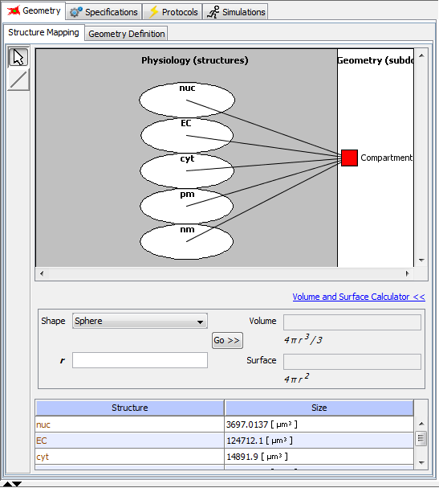
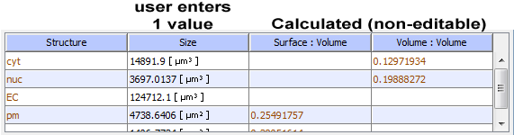

# Structure Mapping for non-spatial geometries

Compartmental BioModel structure mapping (to an empty geometry) is created automatically. However,
it is necessary to define the size (micrometers cubed for volume structures -or- microns squared for
membrane structures) of each compartment.

**Edit or Enter** structure volume within the Structure Mapping table in the bottom panel by editing
the "Size" column. For help determining appropriate values, select "Volume and Surface Calculator"
to bring up a calculator to provide volume and surface area information for common geometries (e.g.
sphere or cube) based on radius or side lengths. Click "Volume and Surface Calculator" again to hide
the calculator. (See below for older model non-spatial structure mapping).

**Note:** If one creates a new non-spatial application by copying a spatial application as
nonspatial, the equivalent compartment sizes will be pre-computed and automatically entered into the
appropriate fields.

**Legacy Non-Spatial Structure Mapping:** VCell models previously used surface to volume ratios and
volume fractions to describe the compartment sizes, Vcell now uses absolute sizes to describe the
sizes of each compartment. For these older models, the values in the "size" column will not exist,
enter a size for 1 of the compartments and VCell will automatically calculate the others from the
surface to volume ratios and volume factions. Once the size has been entered, the table will report
either the size ratio of volume compartment to the parent compartment in which it is contained
(volume:volume) column, or the ratio of a membrane compartment surface to the total enclosed volume
(surface:volume). These two columns cannot be edited.

