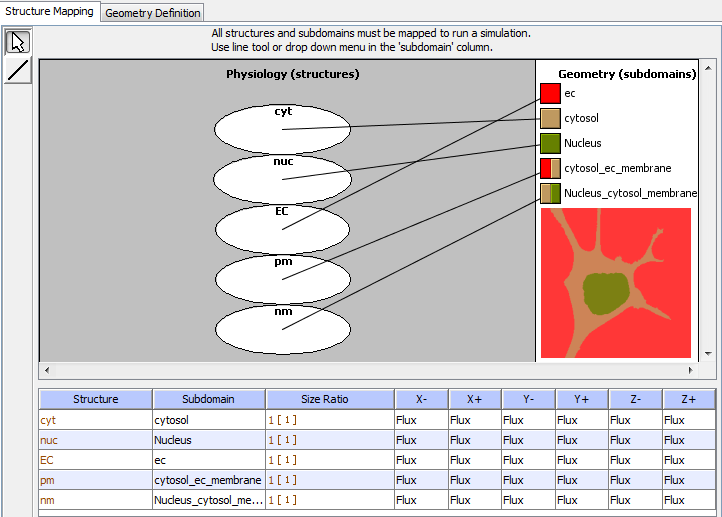

# Structure Mapping for spatial geometries

Spatial BioModel structure mappings are defined within an "Application" after all physiology
compartments and a spatial geometry have been added.

From a selected application click on "Geometry and click the "Structure Mapping" tab. The left panel
depicts the "physiology (structures)", the right depicts the "Geometry (subdomains)" and the bottom
displays a table of the structure mapping assignments.

**Choose** one of the methods below to map each physiology structure to the appropriate geometry
subdomain:

- 1\. For each distinct physiology structure, select the "mapping" tool and click on a point within
  the physiology structure (left panel) and drag the colored square next to the appropriate geometry
  subdomain (right panel). (ignore any 2-color squares, these represent membranes that are defined
  as the boundary between two structures).
- \- or -
- 2\. In the "Structure Mapping" table click the table under the "Subdomain" heading next to the
  "Structure" you want to map and choose a geometry domain from the pop-up list that appears to
  define the mapping.

For applications with SPATIAL geometries the "Structure Mapping" table allows the user to enter
boundary conditions to be used ONLY when the structure intersects the edge of the simulation world
(i.e. the entire simulation domain). Note that for structures mapped to a spatial geometry domain
that do not intersect the edge of the simulation world, this setting will have no effect. In the
"Structure Mapping" table each (-X,+X,-Y,+Y,-Z,+Z) column associated with a structure represents an
edge of the simulation world, where "-X" represents the edge of the simulation world in the minus X
direction and the other columns have similar meaning for the indicated axis (XYZ) and direction
(-+).

**Set** boundary conditions to either "FLUX" or "VALUE" by selecting from the pull down menu in the
appropriate column (-X,+X,-Y,+Y,-Z,+Z) for each structure/subdomain mapping.

- FLUX instructs the solver to use an explicitly defined constant or function to calculate the flux
  (uM.um.s-1) of a species at the simulation world boundary.
- VALUE instructs the solver to use an explicitly defined constant or function to calculate the
  concentration (uM) of a species at the simulation world boundary.

The boundary condition chosen will determine how a species interacts with the simulation world
boundary. The actual constant or function is defined for each species in the (see
[Specifications->Species](../Specifications/SpeciesSpecifications.md)) panel.

<!-- Author comments:
structure mapping table (new compartmental application) does not show surface:volume or volume:volume unless size is changed.
-->
