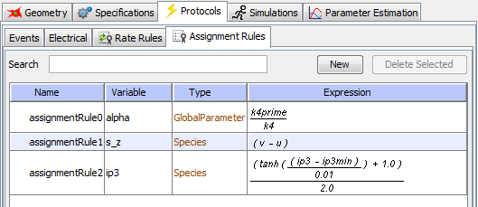
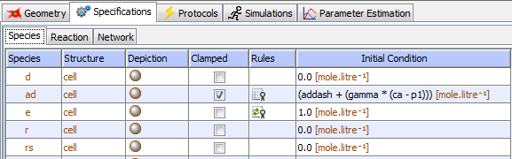

# Assignment Rules

**Assignment Rules** is an alternate way to define the values of Variables in a model and the
relationships between them.

The functional form of an Assignment Rule is **x = f(V)** (left hand side is a scalar) where x is
the variable, f is an arbitrary function returning a numerical result and V is a vector of symbols
that does **not** include x.

The variable may be a reactant or product species already defined in the reaction network. However,
the Species must be **clamped** (in the Specifications / Species panel).

The Assignment Rules screen is a table with four columns.

- **Name** is a user defined name for the rule.
- The **Variable** is the user defined species variable whose value will be determined by the
  assignment rule expression. In general the variable should not be a species already described in
  the reaction network or a predefined variable or constant in VCell.
- **Type** defines the variable type and cannot be edited. Only species variables can be created at
  this time, however it is possible to also import global parameters
- **Expression** is the expression that will be evaluated for define the value of the species
  variable.

**Create a new** Assignment Rule using the New button at the top of the Assignment Rules window.

**Edit** the Assignment Rule by double clicking within the appropriate column. The user must choose
(from a list) a variable name for the **Variable** and enter an appropriate **Expression** for the
value of the Variable.

The **Name** of the Assignment Rule can also be edited.

The Specifications / Species panel has an extra "Rules" column for non-spatial deterministic
applications, where we indicate if a species is being used as a rule variable.

Species used as assignment rule variables must be clamped, otherwise an error will be issued.

In the example above, species **'ad'** is marked with the assignment rule icon and is clamped.
