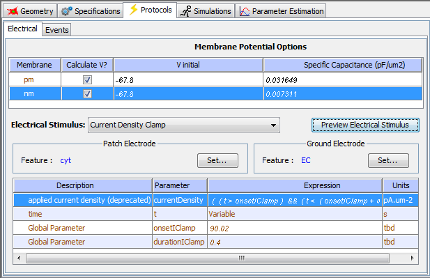
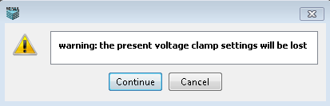
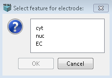
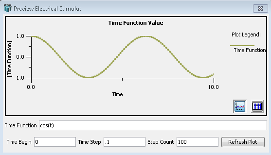

# Electrical Mapping

**Electrical Mapping** in the Virtual Cell allows the user to model cell electrophysiology.
Electrical Mapping specifies the Membrane Potential Options and Electrical Stimulus that can be
applied to flux reactions. Electrical Mapping is available in both spatial and compartmental models.
In compartmental models one cannot specify electrode clamp.

**Viewing/Editing Electrical Mapping**

Electrical mapping can be accessed by choosing the 'Protocols' item in any application in the
'Navigation' panel tree structure. This opens the 'Protocols' tab in the 'View' panel on the right.
In this tab, choosing the **Electrical** tab allows the user to view/edit electrical mapping
parameters for the application.

The **Membrane Potential Options** table lists the membranes in the BioModel. The user has the
option of specifying the initial voltage (**V initial**) and the **Specific Capacitance** of each
membrane. By default the checkbox for calculating the voltage is checked. The user can choose
between four options from the drop-down menu for **electrical Stimulus**: no clamp, voltage clamp
total current clamp or current density clamp. If the user wishes to switch from the voltage/current
clamp to any other clamp options, a warning message will be displayed indicating that the present
clamp settings will be lost.

When 'Voltage' or 'Current' clamps (stimuli) is chosen, the required attributes that can be
specified are displayed in a table. The available electrical stimulus options are:

- **No Clamp**

  There is no stimulus applied across the membrane, so no clamp device is displayed. The 'Patch
  Electrode', 'Ground Electrode', 'Preview Electrical Stimulus' button are disabled for this option.

- **Voltage Clamp**

  A voltage clamp or stimulus is applied across the membrane. When the 'Voltage Clamp' radio button
  is selected, the required attributes for the voltage clamp device, i.e., the features of the probe
  (patch) and ground electrodes, and the voltage expression (in 'milliVolts') can be specified.

- **Total Current Clamp**

  A current clamp or stimulus is applied across the membrane. When the 'Current Clamp' radio button
  is selected, the required attributes for the current clamp device, i.e., the features of the probe
  (patch) and ground electrodes, and the current expression (in 'picoAmperes') can be specified.

- **Current Density Clamp**

  A current density clamp or stimulus is applied across membrane. When the 'Current Density Clamp'
  radio button is selected, the required attributes for the current clamp device, i.e., the features
  of the probe (patch) and ground electrodes, and the current expression (in picoAmperes-2) can be
  specified.

The **Patch Electrode** and **Ground Electrode** can be specified for the different applied
electrical stimulus options. These are features (volumetric compartments) present in the model.
Clicking the **Set** button pops up a dialog that lists the features in the model. Choosing a
feature from the list and clicking **OK** will set the electrode (Patch or Ground) to that feature.

The **Preview Electrical Stimulus** button can be used to preview the chosen electrical stimulus. It
displays the stimulus as a time plot. The user can change the **Time Function**, **Time Begin**,
**Time Step** and **Step Count** in the text fields provided. Clicking **Refresh Plot** button will
refresh the display to reflect the modified 'Time Function'.

