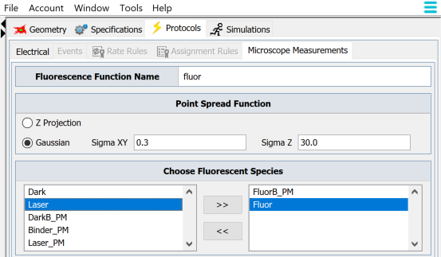

# Microscope Measurements

To better compare simulation data with experimental fluorescent images, 3D simulation data can be
convolved using appropriate functions to approximate what occurs in a fluorescence microscope. Both
z projections and Gaussian convolutions are available. The convolution can involve multiple
different species (e.g. bound and free versions of a protein) to be convolved together and appear as
a single fluorescent species. Once convolved the new "species" is a volume element.

Microscope Measurements are only available for spatial deterministic applications. Only one
fluorophore can created for each Application, so separate Applications are required if you want to
create two simulated fluorescent species with different fluorophores.

**Name** the resulting new "fluorescent species". The default name for the new species is "fluor".

**Select** the appropriate Point Spread Function for the convolution. **Z-Projection** sums the
"fluorescence" for each z to create a single x,y plane. A **Gaussian** Convolution convolves the
image at each point with the specified x and y pixel depths, which can be selected to match the
appropriate resolution of the microscope used to collect images to compare to the "simulated
fluorescence"

**Select species** that should be included as the fluorescent species. and use the "**>>**" button
to transfer each species into list box on the right to be included as fluorescent species. Use the
backward arrows button to remove species from the right side. Any species (membrane or volume) can
be included.

The convolved "simulated fluorescent species" can be viewed in the
[Post Processing Image Data](../Simulations/Results/Spatial/PostProcessingImage.md) tab of the
[Spatial Results Viewer](../Simulations/Results/Spatial/SpatialSimResultsOverview.md).
