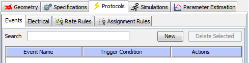
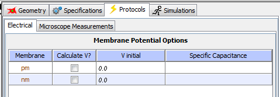

# Protocols Overview

**Protocols** are additional modeling capabilities that are available to users to enhance their
models. Protocols are specified at the application level.

Non-Spatial Deterministic

Spatial Deterministic

**Protocols** can be accessed by clicking the **Protocols** item under any **Application** in the
'Navigation' panel tree structure. This selects the **Protocols** tab for the application in the
'View' panel on the right. The 'Protocols' tab has different sub-tabs depending on the type of
application.

- [Electrical](Electrical.md) mapping protocols are available for all Application types.
- [Events](Events.md) are available for Non-spatial Deterministic (ODE) Applications.
- [Rate Rules](RateRules.md) and [Assignment Rules](AssignmentRules.md) are available for
  Non-spatial Determininistic (ODE) Applications.
- [Microscope Measurements](MicroscopeMeasurement.md) are available for Spatial Deterministic (PDE)
  Applications.
