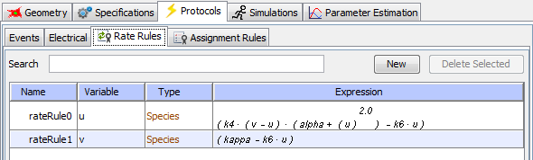
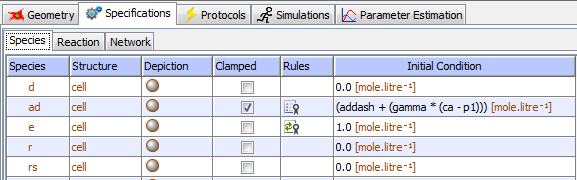

# Rate Rules

**Rate Rules** allow a user to define the rate of change of a variable (species) using a specified
function, rather than describing a kinetic law in the reaction editor. This is convenient for many
ODE applications, and is also used in many SBML models that are imported into VCell.

The functional form of a Rate Rule is **dx/dt = f(W)** (left hand side is a rate of change) where x
is the variable, f is an arbitrary function returning a numerical result and W is a vector of
symbols that may include x.

The variable cannot be a reactant or product species already defined in the reaction network, where
the math will be defined by the kinetic rate law as part of the reaction diagram. Rather, a rate
rule expression defines the rate of change of a variable that can act to catalyze a reaction.

The Rate Rules screen is a table with four columns.

- **Name** is a user defined name for the rule.
- The **Variable** is the user defined species variable whose rate of change (dx/dt) will be
  determined by the rate rule expression. In general the variable should not be a species already
  described in the reaction network or a predefined variable or constant in VCell.
- **Type** defines the variable Type and cannot be edited. In VCell, a new "species" is created in
  the math description for the variable, and the value of the variable will be reported in the
  results as a species concentration.
- **Expression** is the expression that will be evaluated for define the value of the variable
  (species).

**Create a new** Rate Rule using the New button at the top of the Rate Rules window.

**Edit** the Rate Rule by double clicking within the appropriate column. The user must choose
(select from a list) a species for the **Variable** and enter an appropriate **Expression** for the
rate of change.

The **Name** of the Rate Rule can also be edited.

The Specifications / Species panel has an extra "Rules" column for non-spatial deterministic
applications, where we indicate if a species is being used as a rule variable.

In the example above, species **'e'** is marked with the rate rule icon.
