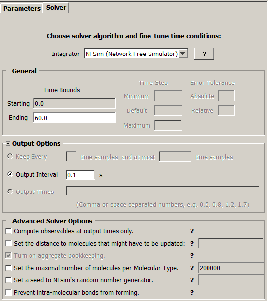

# NFSim Simulations Editor

**Integrator** is NFsim biochemical reaction simulator designed to stochastically simulate systems
that have a large or even infinite number of possible molecular interactions or states. A
publication describing NFsim can be found at
https://www.nature.com/nmeth/journal/v8/n2/full/nmeth.1546.html. A user can set end simulation time,
output interval N (simulations results are outputted every N seconds) and Advanced Solver Options.

**Advanced Solver Options**

- **Compute observables at output times only** (NFSim option -notf). By default, observables are
  calculated on-the-fly, updating all observables at each simulation step. This is necessary when
  rates of reactions depend on Observables. By checking this box, the values of Observables will be
  computed only at output steps. It can not be set if functions are used, as functions rely on
  having updated Observables at any point in a simulation.This will allow simulations to run faster
  if the number of simulation steps between each output step is greater than the number of molecules
  in the system. This may or may not be true for your simulation, so you should try turning on or
  off this option to see which is more efficient.
- **Set the distance to molecules that might have to be updated** (NFSim option -utl \[integer\]).
  The universal traversal limit (UTL) sets the distance neighboring molecules have to be to the site
  of the reaction to be updated. The default UTL is set to the size of the largest reactant pattern,
  which is guaranteed to produce correct results because NFsim will always find the changes that
  apply to every reactant pattern in the system. Sometimes however, based on the structure of the
  reactant patterns, the UTL may be set lower. The lower is the UTL, the less molecules will be
  checked and the faster simulation will go. If the limit is too low, not all molecules are
  correctly being updated, then results will be incorrect. In many cases, however you may have a
  very large pattern, but the maximal number of bonds you need to traverse to make sure that pattern
  can always be matched is low. This will happen, for instance, when many molecules are connected to
  a single hub molecule. **Default: the size of the largest reactant pattern in the rule-set.**
- **Turn on aggregate bookkeeping - always ON.** (NFSim option -cb) NFsim by default tracks
  individual molecule agents, not complete molecular complexes. This is useful and makes simulations
  very fast, but is not always appropriate. For example, in some systems it is necessary to block
  intra-molecular bonds from occurring to prevent unwanted ring formation. However, to check for
  intra-molecular bonding events, complete molecular complexes must be traversed. NFsim, provides an
  aggregate bookkeeping system for molecular complexes that form by assigning each connected
  aggregate a unique id. Then, it becomes easy to check if any two molecules are connected. The
  trade-off is that there is an overhead involved with maintaining the bookkeeping system with a
  cost that depends on the size of the molecular complexes that can form. **Default: ON, because
  VCell generates observable for every species.**
- **Set the maximal number of molecules per Molecular Type.** (NFSim option -gml \[integer\]) To
  prevent a computer from running out of memory in case too many molecules are created, NFsim sets a
  default limit of 200,000 molecules of any particular Molecule Type from being created. If the
  limit is exceeded, NFsim just stops running gracefully, thereby potentially saving your computer.
  N**Default: 200,000**
- **Set a seed for NFSim's random generator.** (NFSim option -seed \[integer\]) Provide a seed to
  NFsim's random number generator so exact trajectories can be reproduced. If this line is not
  entered, the current time is used as a seed, producing different sequences for each run.
- **Prevent intramolecular bonds from forming.** (NFSim option -bscb) Block same complex binding
  throughout the entire system. This prevents intra-molecular bonds from forming, but requires
  complex bookkeeping to be turned on.
