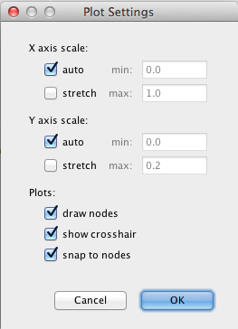

# Compartmental Simulation Results Plot Settings

The simulation results plot graph is interactive. Move your cursor over the graph, a crosshair will
appear and the corresponding X and Y coordinate values will be displayed in the bottom left corner
of the dialog. Right click your mouse in the plot area to access Plot Settings.

- Axis Scale: Select either auto scale mode or deselect for manual scale model. When in manual mode
  you must supply min and max graph values.
- Auto Scale: Computer will calculate best values for displaying graph. 
- Stretch: In auto mode, use to stretch graph for better viewing.
- Plots: Plot display options.
- Draw nodes: Select to draw a node at each data point.
- Show crosshair: Enable the crosshair to be displayed when you move your mouse over the graph.
- Snap to nodes: Select to have crosshair snap to nodes, deselect to move crosshair freely across
  the graph.
