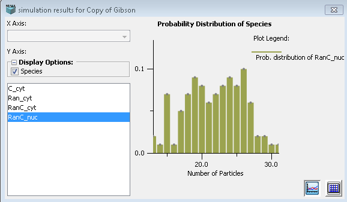

# Stochastic Simulation Results Histograms

Histogram of Stochastic Simulations: (See also
[Non-spatial results overview](SimCompartmentResults.md)) For Stochastic Applications, when multiple
trials of a stochastic simulation is run (See stochastic section of
[Numerical Solvers](../../numerical_solvers.md)), the results of the final run are displayed as a
histogram instead of a plot. The X-axis of the histograms is auto-ranged to the possible values for
the variable plotted on the Y-axis. The Y-axis is the calculated distribution of the variable over
the range of possible values based on the results of the simulation trials. The calculated values
for the distributions can be viewed by using the toggle button.

