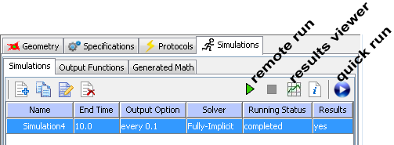
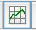

# Simulation Results

The **results viewer** button is enabled when a selected simulation has data stored on the remote
VCell server. Simulation data are generated when the user presses either the **remote run** or the
**quick run** button (see simulation tab figure below). For 'remote run' simulations, data are saved
remotely and the 'results viewer' button will become enabled as soon as data is available on the
VCell server. Pressing the results viewer button displays data that is continuously updated as the
simulation run proceeds on the VCell server. For 'quick run' simulations, data are not saved
persistently and the results viewer is displayed automatically once the simulation run has completed
on the users local computer.

Follow the links below for more information on the 2 kinds of **Results Viewer**:

- [Spatial.](Spatial/SpatialSimResultsOverview.md)
- [Non-spatial](Nonspatial/SimCompartmentResults.md)(compartmental) and non-spatial stochastic
