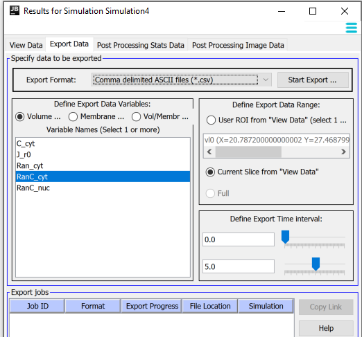

# Exporting Spatial Simulation Results

Results from remote simulation runs are automatically stored on the remote database server.
Simulation results may be exported in different formats including movie, image, spreadsheet, polygon
and raw file types. Both volume and membrane data can be exported depending on the file format
chosen. Exporting non-floating point image (gif; jpeg) or movie based formats will use the color
scaling set in the [View Data](SimResSpatialSliceView.md) panel to convert 'data values' to 'pixel
colors'. Exported

**Export Data Panel**

**Select Export Format** from the dropdown menu. Available formats are:

- **Comma delimited ascii (\*.csv)** for spreadsheet formats. Each data point value is separated
  with a comma (,) and rows are separated corresponding to the ROI or slice 'X' spatial dimension.
- **HDF5 files (\*.hdf5)**. Stores floating point values as multi-dimensional arrays in a
  heirarchical format defined by the HDF5 standard. HDF5 files from volume data can be read using
  [ImageJ/Fiji](OpenHDF5ImageJ.md)
- **QuickTime(QT,QTVR) movie (\*.mov)**. QTVR is a special version of QT formatted to allow the
  Apple QuickTime movie player (https://www.apple.com/quicktime/) to display an extra dimension of
  data (e.g multiple slices/variables over time).
- **GIF** image or animated GIF image file
- **JPEG** or animated JPEG image file
- **Nearly Raw Raster Data (\*.nrrd)**. Data is saved as the floating point variable value displayed
  in an image format; this file can be read by a number of programs including FIJI/ImageJ
- **ImageJ compatible remote storage (\*.N5)**. Data is saved to VCell servers in the N5 format.
  Files exported as N5 files can be viewed from the server without download using a FIJI/ImageJ
  [VCell Simulation Results Viewer](ImageJDataViewerPlugin.md)
- **ucd (\*.ucd)**. Stores data values in a polygon format (volume or surface) for each value based
  on the simulation spatial geometry (mesh). Programs such as 'VisIt' (https://visit.llnl.gov/) and
  'ParaView' (https://www.paraview.org) can open most polygon formats for further analysis.
- **Stanford Poly Texture file (\*.ply)**. Stores data values in a polygon format (volume or
  surface) based on the simulation spatial geometry (mesh)
- **VTK (\*.vtk)**. Stores data values in a polygon format (volume or surface) based on the
  simulation spatial geometry (mesh). See https://www.vtk.org for more information

**Define Export Data Variables** by selecting one or more volume and/or membrane variables from the
list to export. The radio buttons can be used to select the types of variables to view in the list.
Types of variables that can be exported will depending on the file format chosen and unavailable
items will be greyed out.

**Define Export Data Range** by selecting one of the buttons from the list.

- **User ROI** to select an available ROI created using the
  [ROI drawing tools](SpatialSimResultsDrawingTools.md) in the Results Viewer
- **Full** to select all simulation data points to export.

**Define Export Time Interval** using the sliders or entering directly the start and end time.

**Start Export** by selecting this button once the export parameters have been defined. After you
start the export an additional dialog box may appear depending on export file type. See
[Specific Format Settings](SpecificFormatSettings.md) for information related to each specific file
format. Starting the export will signal the VCell server to create the specified file format and
return it to the user's local computer.

The **Export progress** panel displays the job ID and progress. Once the export file has been
created, a 'save' dialog will be displayed to save the file on the local computer as a zip file.
