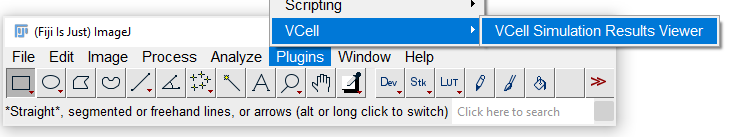
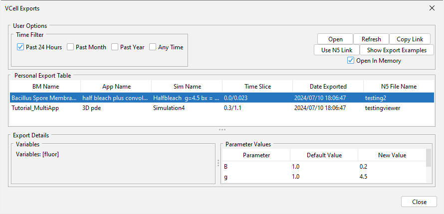

# FIJI/ImageJ VCell Simulation Results Viewer Plugin

Spatial Simulation Results exported as N5 files can be directly viewed or downloaded from VCell
servers using a VCell Simulation Result Viewer Plugin.

The VCell Simulations Results Viewer plugin to FIJI/ImageJ can be installed from
https://sites.imagej.net/VCell-Simulations-Result-Viewer/.

**Select the VCell Simulations Results Viewer plugin** from the plugin list in FIJI/ImageJ to open
the Exported Simulation Results Viewer. The table lists all spatial simulation result sets exported
as N5 files using the current local computer. For each exported dataset, the table reports the
associated BioModel Name (BM Name), Application Name (App Name), Simulation Name (Sim Name), Time
Slice exported, and Date Exported.

**Filter** by selecting or deselecting the check box for Time Interval since the data was exported.

**Open** a selected N5 file in FIJI/ImageJ. By default, the **Open in Memory** is selected, and the
file will open in the local computer memory. If the dataset is very large, you may **uncheck the
Open in Memory** to view directly from the server without loading the file into your computer's
memory. This feature allows the user to view and analyze datasets that are too large to hold in
memory. Note however, that changing views or using analysis tools can be much slower depend on your
internet connection speed.

**Refresh** the table after changing any of the filters or if you have exported new datasets from
VCell.

**Copy Link** copies the path to the VCell server location for the selected dataset. The link will
allow other analysis software access to the data. The link can be shared with others and provides
access only to the specific exported dataset.

**Use N5 Link** opens the selected N5 dataset in ImageJ.

**Show export examples** changes the table to a list of example datasets that can then be opened or
viewed in FIJI/ImageJ. **Show My Exports** returns the table to the list of exports from the local
user.

**Export Details** describe the variables exported

A **Parameters** table lists any Application parameters overwritten from default values for the
Simulation that was exported.

N5 files store floating point values for concentrations or arbitrary units for convolved species.
Use the Image>Adjust>Brightness/Contrast function to adjust the display appropriately. In addition
to a channel for each species included in the exported results, an additional channel displays the
volume structures in the simulation geometry as different pixel values.
