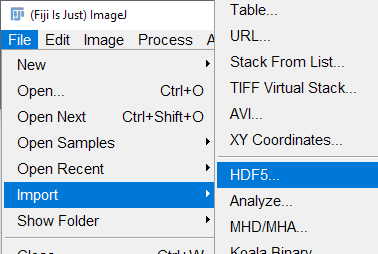
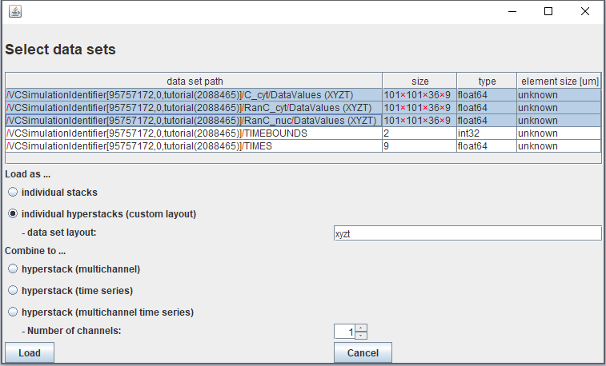

# Importing HDF5 files into FIJI/ImageJ

HDF5 files exported from spatial simulation results, can be viewed using either a dedicated HDF5
viewer (see https://www.hdfgroup.org/downloads/hdfview/)or FIJI/ImageJ (see
https://imagej.net/software/fiji/). Instructions for importing HDF5 files into ImageJ is given here.

**HDF5 files (\*.hdf5) exported from spatial simulations**

Data are saved as multi-dimensional arrays in a heirarchical xyzt format defined by the HDF5
standard. To open the files in ImageJ, from the **File menu** select **"Import" then "HDF5"**

**Select** all of the datasets ending in ".../DataValues (XYZT)" to be imported. If you exported
data for multiple variables in a single HDF5 file, the data for each variable appears as a separate
data set path in the table.

**Click "Individual Hyperstacks (custom layout)"** and **enter "xyzt"** in the text box. (Note that
it is not yet possible to use the "Combine to..." functions with the exported VCell HDF5 files.)
Then **select "Load"**

The hyperstack viewer with the image will appear. If multiple files were selected, each will appear
in a separate image window; the variable represented by each image will be at the end of the rather
long filename for the hyperstack datset. Note that the distance scales will not be imported and
should be manually changed ("Image"->"Properties") to accurately reflect the mesh size (x,y, and z)
in the simulation.

Pixel values in the image are the actual concentration values from the simulation. You will need to
adjust the image brightness to correctly display the image (Image->Adjust->Brightness/Contrast).

The images will be rotated and flipped compared to the image view in the VCell databrowser. To align
with the VCell viewer, use "Image->Transform->Flip Vertically" and "Image->Transform->Rotate 90
degrees right" functions in ImageJ.
