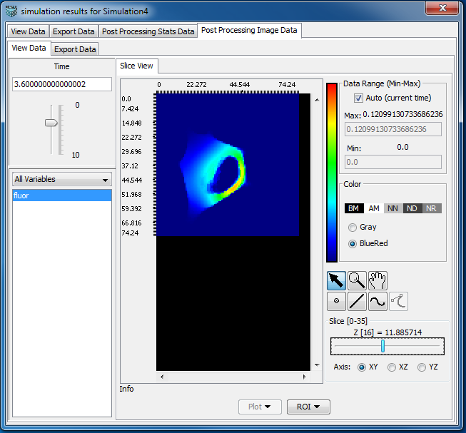

# Post Processing Image Data

The Post Processing Image Data panel, accessed as a tab in 3D simulation results, gives access to
"microscope" images derived from 3D data through Z-projections or gaussian convolution. (Note: The
panel will indicate "No Data" if data you are viewing was generated from a simulation run on a
version of VCell earlier then 5.2 or if flourescence functions were not specified prior to the
simulation run)

**Post Process Image Data:** If a point spread function for one or more flourescence functions was
selected in the [Microscope Measurements](../../../Protocols/MicroscopeMeasurement.md) tab under
Application [Protocols](../../../Protocols/ProtocolsOverview.md) (prior to running a simulation),
computed images for each flourescent function can be selected from the list under the PostProcess
Image Data label. The image will appear in the pane to the right. At the lower left is a time
slider. In the case of Z Projections, a single two dimensional image is produced. For gaussian
convolution, a slider at the lower right of the panel allows one to browse through Z slices.
