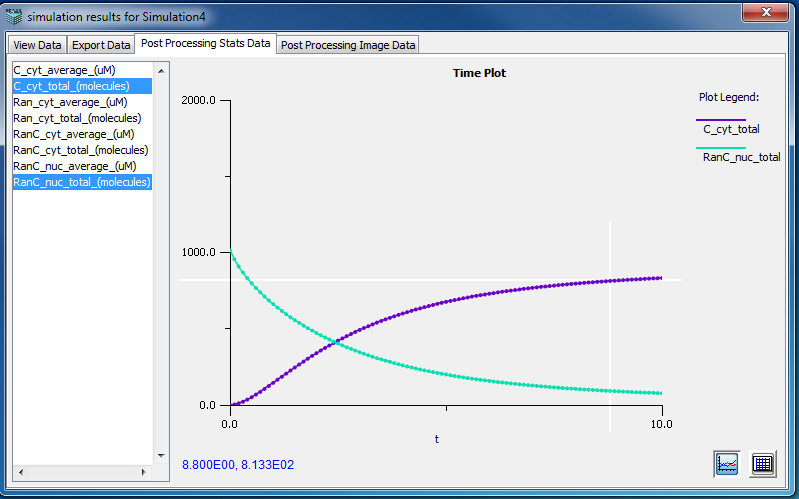

# Post Processing Statistics Data

The Post Processing Statistics Data panel, accessed as a tab in 3D simulation results, gives access
to derivative information from result data sets such as average values of spatial variables within a
compartment over time. (Note: A No Data message will appear if the data you are viewing was
generated from a simulation run on a version of VCell earlier then 5.2)

**Post Processing Variable Statistics:** To view one or more compartmental average values of
variables, select the variable names in the list and a graph of values over time will appear in the
right hand pane. The data in tabular form can be accessed by clicking the spreadsheet icon at the
lower right of the graph pane, and toggled back to graphical form with the adjacent graph icon.
Note, to select multiple variables, press the Control key while clicking on variable name of
interest.
