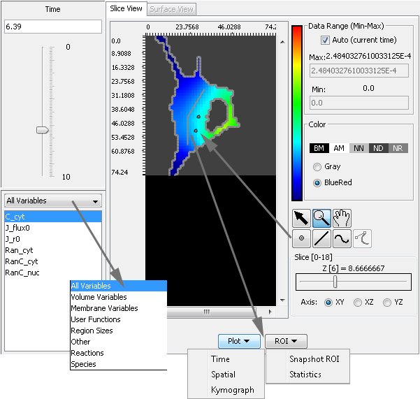

# Spatial Simulation Results Slice/Surface View

The main interactive viewer for simulation results. **Slice viewer** controls for **volume
variables** allow the user to select a **variable**, a specific simulation **time-point**, a
**slice** plane if 3D, a **data range** for display color scaling, a **color** colormap for basic
display settings. Other controls include zoom, pan, region-of-interest(roi) (point, line, simple
open and closed polygons), roi plots and statistical summary plots. **Surface viewer** controls
allow for the manipulation in 3D of surface rendered **membrane variables** and the definition of
regions-of-interest.

**Slice View tab** tab. Displays volume and membrane data as an orthogonal slice (z,y,z) image.

- **Time panel-**
- Sets a simulation time-point to display in the viewer. Update the currently displayed data by
  editing the text field, sliding the time pointer or using the up-down arrows on a keyboard.
- **Variables button menu-** Drop-down variable category selector and variable list. Category
  selection changes the variable names displayed in the variable list. Selection from the variable
  list sets a variable to display in the viewer.
- **Slice panel-** Use radio-buttons to select orthogonal plane orientation. Move slider to set
  depth of visible slice plane within the data.
- **Data Range/Color Scale panel-** see [Data Range/Color Scale](SimResultsDataRange.md)
- **Tools panel-** see [Slice View tools](SpatialSimResultsDrawingTools.md)
- **ROI button menu-** Selecting **Snapshot ROI** will create an ROI from the currently displayed
  variable that includes all points that equal one (1.0). Selecting
  [Statistics](SimResultsSpatialROIandStatistics.md) will show a dialog listing a set of predefined
  ROIs (including any snapshot ROI) and controls to generate some simple statistics.
- **Plot button menu-** see [Plot](SimResultsKymograph.md)

**Surface View** tab.

- **Surface View tab-** see [Surface View](SimResultsSpatialSurfaceView.md)
