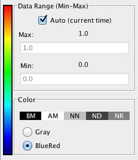

# Data Range/Color Scale

Auto Range: Select to have the software automatically adjust the image display pixel intensities
based on the minimum and maximum data values for the selected time point. The intensities are
automatically converted to and displayed as concentrations.

Min/Max: Deselect Auto Range and type in the value(s) for the minimum and/or maximum; press enter to
accept the values and to update the image display.

Color: View the image data either in Grayscale or in a Blue-Red color map where colors are mapped
according to concentration. At times some values will be displayed in colors other than the selected
color map because they do not fall within the specified range.

Color Value:

BM: Below minimum color

AM: Above minimum color

NN: Not a number color

IL: Illegal value color

NR: No range color
