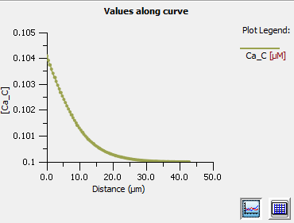
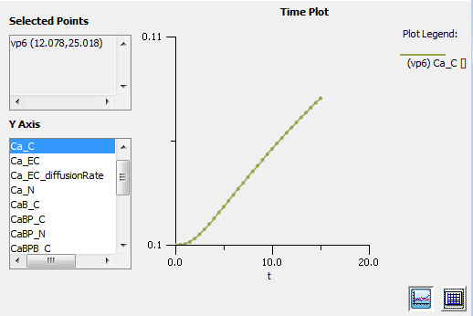
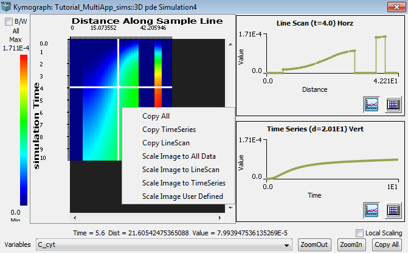

# Simulation Results Viewer Plots

The **Plot->Spatial** menu-button item is enabled once you use the line or spline tools to define a
region. Select the created line or spline, select Plot->Spatial to display a plot of the data along
the line or spline. The graph is interactive; as you move the mouse over the graph, the coordinates
are displayed in the bottom left corner.

Select from plot or table of values display by selecting icons located in the lower right area of
the dialog.

The **Plot->Time** menu-button item is enabled once you use the point tool to define a point or
series of points. Select Plot->Time to view a line graph of currently selected simulation data
variable at each timepoint over time. Point coordinates are listed in the top left corner of the
Time Plot frame. Use the 'Y Axis' list to select 1 or more variables to plot.

Select from plot or table of values display by selecting icons located in the lower right area of
the dialog.

The **Plot->Kymograph** menu-button item is enabled once you use the line or spline tools to define
a region. The kymograph displays line scans over time as 2D image with the X axis representing
distance along the ROI line and the Y axis representing time. Two graphs display the simulation data
values of the kymograph with the top graph displaying the horizontal crosshair values (values along
the ROI at 1 time point) and the bottom graph displaying the vertical crosshair data values (values
along time at 1 ROI point). These plots will update according to the position of the crosshair in
the image data panel which can be moved by clicking the mouse or using the arrow keys.

- Variable - Select data variable.
- Zoom In/Out - Select either button to change zoom display of image data.
- Copy all - Use this function to paste data into a program other than the Virtual Cell.
- Local Scaling - Select this checkbox to change the minimum and maximum y-axis values used to plot
  the 'Line Scan' and Time Series' graphs. The y-axis min and max are calculated separately for
  'Line Scan' and 'Time Series' using only the data to be plotted instead of the whole kymograph
  data set.
- Image Data Mouse Menu - Use the right mouse button, over the image data to access the following
  options: 'Copy All', 'Copy Time Series', 'Copy Line Scan', 'Scale Image to All Data', 'Scale Image
  to Line Scan', 'Scale Image to Time Series' and 'Scale Image User Defined'. 'Copy ...' menu items
  transfer data to the clipboard for use in non VCell programs (e.g. spreadsheets). 'Scale ...' menu
  items recalculate the minimum and maximum values used to create the display colormap.
