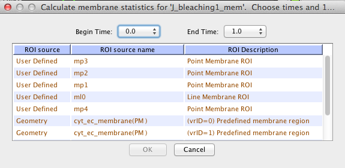

# Statistics

Drawing tools are used to define spatial regions of interest and obtain tabular and graphed results
(statistics) from such specified regions.

Statistics: the minimum, weighted mean and maximum can be calculated for variables in a Region of
Interest (ROI). Volume and Membrane variable statistics are calculated when any given data variable
is selected in the results viewer variable list and the 'ROI->Statistics' button-menu is selected. A
dialog will be displayed with selectors for setting a time range (Begin Time, End Time) and a list
of available ROIs. ROI source shows if the ROI has been predefined by Geometry or User Defined (e.g.
by using the point or spline tools to create the ROI). The ROI Source Name is either taken from the
Geometry or generated automatically as the user creates the ROI (e.g. vp1, vp2... for volume points
in order of creation). The ROI description provides additional information on the ROI type (e.g.
Point Volume, Areas Enclosed Volume).

Snapshot ROI:To plot statistics for an ROI, select the range of times and one or more ROI sources
(ctrl-click) that you wish to examine and press OK.

