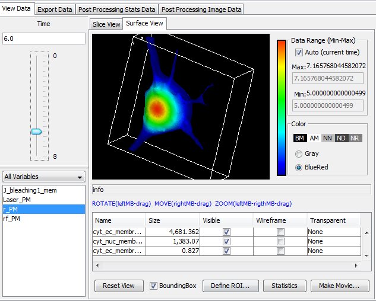
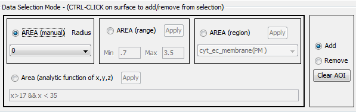
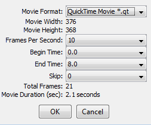

# Membrane Surface Viewer

The Membrane Surface Viewer displays a membrane variable as a 3D rendered surface that can be
rotated, zoomed and panned. Hovering the mouse pointer over a point on the surface displays the
variable's value. The rendered display is initialized with the color scaling and data values for the
current membrane variable name and time point.

- **Rotate (mouse) -** The view may be rotated arbitrarily using a "trackball" interface by dragging
  the mouse with the left mouse button (leftMB) pressed. The view rotates as if the mouse were
  attached to a sphere containing the surfaces. The amount of possible rotation depends on where the
  mouse is when the leftMB is first pressed and the direction of drag.
- **Pan (mouse)-** The view may also be moved side to side and up or down by dragging the mouse with
  the right mouse button (rightMB) pressed.
- **Zoom (mouse)-** The view can also be zoomed closer or farther away by dragging the mouse with
  the left and right mouse buttons (leftMB-rightMB) pressed.
- **Point Info (mouse)-** Hover the mouse pointer over a point on the surface and the data value and
  centroid location will appear below the render display.
- **Reset View (button) -** Resets the rotation, pan and zoom (mouse) to the default orientation to
  center the surface in the display area.
- **Bounding Box (check-box)-** The bounding box outlining the entire simulation data volume can be
  turned on/off using the check box at the bottom of the viewer panel.

The **Surface Table** contains information and controls to adjust the display of the rendered
membrane surface. Each row represents an individual surface with the following column information:

- **Name -** Membrane surface identifier.
- **Size -** Surface area given in square microns.
- **Visible -** Check-box allows the user to turn on and of the viewing of surfaces. Making a
  particular surface invisible allows for viewing interior surfaces that would otherwise be ob-
  scured.
- **Wire-frame -** Check-box allows the user to produce an outline of each simulation mesh volume
  element. The resulting outline is only a gross approximation of the actual computational surface
  used to generate the simulation data.
- **Transparent -** Menu button contains settings to make a surface less opaque. The larger the
  number selected, the more any underlying surfaces will show through on the display.

**Statistics button** Starts calculation of minimum, maximum and mean statistics on the currently
define ROI.

**Define ROI... button** shows dialog with options to define different kinds of region of interest
(ROI) settings. Cntrl-click the mouse over the surface once an ROI mode has been set.

- **Add** User cntrl-click on a surface will add membrane elements to the ROI.
- **Remove** User cntrl-click on a surface will remove membrane elements from the ROI.
- **Clear** Resets the ROI. All membrane elements are removed from the ROI.
- **Area(manual)** User cntrl-click on surface will add/remove membrane elements to the ROI around
  the click point. The size of the area affected is set with the 'radius' menu-button.
- **Area(range)** Enter minimum and maximum membrane data values to add/remove from ROI then click
  'Apply'.
- **Area(region)** Select whole pre-defined membrane surface to add/remove from ROI then click
  'Apply'
- **Area(analytic function of x,y,z)** Enter an expression as a function of the simulation spatial
  domain that will add/remove from the ROi wherever the function evaluates to 'true' then click
  'Apply'. (e.g. 'x>5 && x<10' will affect all membrane elements that lie within that spatial range)

**Make Movie... button** Shows dialog with options create a 'QuickTime' formatted movie sequence
over selected timepoints using all the settings for the current surface view

- **Movie format -** Select type of movie file to create.
- **Movie width/height -** Displays the size of each movie frame. These values are taken from the
  surface render display panel and can be changed by making the main surface viewer window larger or
  smaller.
- **Frames per second -** Sets the playback speed for the finished movie.
- **Begin/End/Skip Time -** Select which timepoints from the simulation data are used to create the
  movie frames.
- **Total Frames/Movie Duration -** Displays information about the final movie based on the other
  settings in the dialog.
