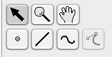

# Region of Interest Tools

Tools are available to adjust the viewer display and define regions of interest (ROI). Tools include
a selection tool that displays individual data point values, zooming and panning tools, and tools to
add and edit single point markers, lines and curves to define ROIs.

**Creating/Selecting Regions of Interest (ROI):**

Use the point, line or curve tools to create a ROI by clicking to add single points or extend line
segments. An enclosed region ROI can be created with the line tool by overlapping the end point with
the start point. To examine data associated with an ROI use either the
[Plots](SimResultsKymograph.md) or [Statistics](SimResultsSpatialROIandStatistics.md) dropdown menus
in the Slice Viewer. [Statistics](SimResultsSpatialROIandStatistics.md) can also be used to create
and view data from 3D regions of interest.

**Select** a line or volume ROI item using the selection tool. **Delete** ROI items by selecting the
item and using either Backspace or Delete.

**Adjust image magnification** by selecting the zoom tool and dragging with the mouse across the
image to increase or decrease the image zoom.

**Pan** accross the image using the pan tool. Select the Hand icon and hold down the left mouse
button and drag the mouse across the image to move it.

**Create a point roi** using the point tool. When a point is created a time plot can be created
using the [Plots](SimResultsKymograph.md) dropdown box. If multiple points are created they will be
plotted on the same time graph.

**Create a straight line** by selecting the line tool and click once at the beginning point and once
at the end point. When a line is selected (highlighted white), the
[Spatial Plots](SimResultsKymograph.md) are enabled using the Plots dropdown box. Either **Spatial**
or **Kymograph** plots will be available.

**Create a curved line** by selecting the Curve tool and click on at least 4 points to create a
spline curve defined by successive clicks of the curve tool.

**Add a control point** by selecting the Add Control Point tool and click to add points to a
selected line or curve ROI.
