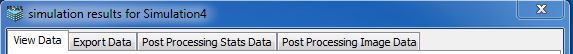

# Spatial Simulation Results Overview

Simulation solvers producing 1,2 or 3 dimensional spatial domain results are viewed with the Spatial
Results Viewer. Controls are provided for selecting variable, time-point, slice-plane, color
scaling, region-of-interest (ROI), data plots and statistics. Volume data are displayed as
orthogonal slices and membrane data are displayed as surface renderings. A pointer can be used to
interactively find data values on single mesh points. Collections of data can be exported in various
formats. Pre-defined simulation statistics and protocol image views are also available depending on
user settings.

- [View Data](SimResSpatialSliceView.md) tab contains the main viewer to display spatial data as
  orthogonal (x,y,z) slices for volume data or surface renderings for membrane data.
- [Export Data](ExportingSpatialSimResults.md) tab is used to select variable, time and roi data to
  export in movie, image, mesh, raw and spreadsheet formats.
- [Post Processing Stats Data](PostProcessingStats.md) tab displays compartment summary data (mean,
  sum) automatically generated by VCell solvers at each simulation time-point.
- [Post Processing Image Data](PostProcessingImage.md) tab displays data generated by
  [Protocol Microscope Measurement](../../../Protocols/MicroscopeMeasurement.md) definitions.
