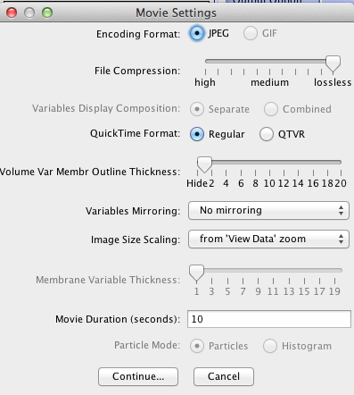
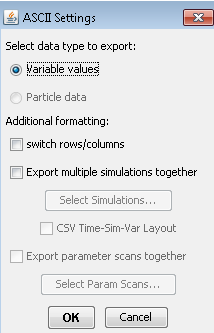

# Specific Format Settings

**Image** based (gif, jpeg, quicktime mov), **text** based (spreadsheet csv) and KDF5 export formats
will display an additional dialog when the 'start export' button is pressed. The dialog displays
additional controls that alter the appearance or structure of the final export file.
**Point/Polygon** based (vtk, ucd) formats have no additional dialogue.

**Image Based (gif, jpeg, quicktime mov)** settings dialog

- **Encoding Format** setting will be 'JPEG' for jpeg image and QuickTime movies. The setting will
  be 'GIF' for gif images.
- **File Compression** slider is enabled for jpeg and QuickTime formats. Any position other than
  'lossless' will create smaller export files at the expense of image quality. The slider is
  disabled for GIF image export as that format always uses 'lossless' compression.
- **Variables Display Composition** is enabled if more than 1 variable has been chosen for export.
  The 'Separate' button creates a separate export file for each variable chosen to export. The
  'Combined' button creates a 'montage' of all the variable images in one export file.
- **QuickTime Format** is enabled for QuickTime format type. The 'Regular' button creates a normal
  QuickTime movie, 1 image for each frame of the movie. The 'QTVR' button creates a specially
  formatted export file for QuickTime players that allows display of multiple images at each movie
  time point as controlled by the user (see Apple QuickTime QTVR) for more information).
- **Volume Var Membrane Outline Thickness** . 'Hide' will disables the rendering of a membrane
  outline to the slice plane being exported; numerical slider values will render membrane outlines
  of selected thickness (pixels) similar to membrane outlines shown in the Slice Data Viewer.
- **Variables Mirroring**. For settings other than 'No mirroring', creates a 'flipped' copy of each
  image along the selected axis. This setting is a convenience to create 'whole' images from partial
  simulation geometries that take advantage of spatial symmetries.
- **Image Size Scaling** . If 'from View Data zoom' is chosen the exported images will be the same
  as the View Data display. Otherwise exported images horizontal and vertical axes will be stretched
  by the scaling value chosen.
- **Membrane Variable Thickness** is enabled when membrane variables are being exported. The slider
  sets the size in pixels of the rendered membrane in a slice.
- **Movie Duration (seconds)** is enabled when QuickTime mov format is chosen. Sets the amount of
  time the movie will take to do one complete play-through.
- **Particle Mode** is enabled when a 'particle' variable is chosen for export. Selecting
  'Particles' creates 'spheres' rendered at their location in space for the exported slice and
  times. 'Histogram' exports an image where each pixel in a slice is colored according to the number
  of particles at the corresponding point in the mesh at each time.
- **Select Continue...** to continue the export. A summary of the settings you have chosen and the
  resulting export file sized will be displayed.

**HDF5 or CSV (text based spreadsheet)** settings dialogue

- **Variable values** Saves file as comma separated text of simulation data values. For 'slice'
  exports, the values will be arranged in a row/column grid corresponding to the x,y values of the
  slice. For 'User ROI' exports, the values are saved as a row of values sampled by the ROI.
- **Particle data** Enabled for 'Spatial Stochastic (smoldyn solver)' simulation data. Saves file as
  comma separated text of the x,y,z location of each 'particle' for each simulation timepoint. GUI
  reference (Simulations tab->Edit Simulation button->Solver tab->integrator menu-button->smoldyn,
  then under 'advanced solver options' check box 'save particle files'). See 'Settings for Spatial
  Stochastic Solver' in [Simulation Editor](../../simulationEditor.md).
- **switch rows/columns** Transpose the ordering of data values in the output file.
- **Export multiple simulations together** Enabled if the 'MathModel' or 'BioModel application'
  parent of the simulation contains other simulations. Select check-box, click 'Select simulations',
  choose additional simulations. Data will be exported from the additional simulations and saved in
  the export file using the same settings for the current export. Check-box **CSV Time-Sim-Var** is
  used to change the ordering of simulation data in the export file. Time-Sim-Var ordering may be
  preferable depending on the user's needs.
- **Export parameter scans together** Enabled if the simulation has any parameter scans defined.
  Select check-box, click 'Select Param Scans...', choose scans. Exports all selected parameter scan
  data together in the same file using the current export settings. See 'Parameters' in
  [Simulation Editor](../../simulationEditor.md) for a description of parameter scans.
