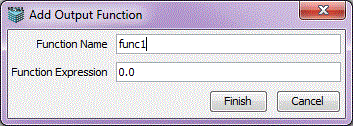
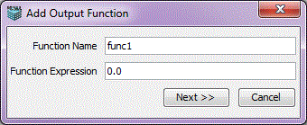
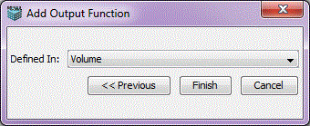
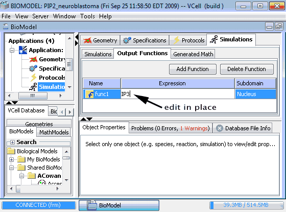

# Output Functions

Output functions are user defined functions for simulation results in a biomodel application or math
model. Output Functions are saved with the model and available for viewing in all simulations in the
containing application or math model.

Output functions are defined as vcell expressions. Symbols that can be used in the expression of an
output function are:

- t
- x, y, z : spatial models only
- model variables
- [predefined mathematical functions](../../ParametersAndFunctions/PredefinedConstAndMathFns.md)
- previously defined output functions

After an output function is added, it will be automatically added to all simulation result viewers.

In spatial models, output functions are defined in a specific subdomain, either in a volume or on a
membrane. This determines the function type of an output function. In subdomains where an output
function is not defined, Gray color will be displayed with "Undefined" as the value in results
viewer.

- **Add Function**

- In a non-spatial biomodel application or math model, click **Add Function** button to add an
  output function. After editing the name and expression (autocomplete help is available to list the
  possible variables that can be used in the expression), click the **Finish** button to add the
  function. Clicking **Cancel** button will cancel the operation.

  

  In a spatial biomodel application or math model, click **Add Function** button to add an output
  function. After providing name and expression, click **Next** to go to the next panel that allows
  the user to choose where the function is to be defined. The drop down menu with the **Defined in**
  label lists the possible options (domains in the geometry) where the function can be defined.
  Choose the domain where the function should be defined and click **Finish** to add the function.
  To change the name or expression of the function, click the **Previous** button. To cancel the add
  operation, click **Cancel**.

  

  

- **Delete Function**

- Select a function in the table, click "Delete Function" button to delete a function.

- **Edit Expression**

- After a function is added, expression can be changed by double clicking the expression column.

  

Remember to save the model after a function is added or deleted.
