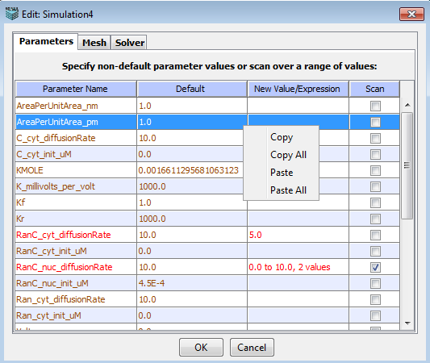
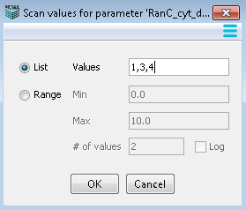
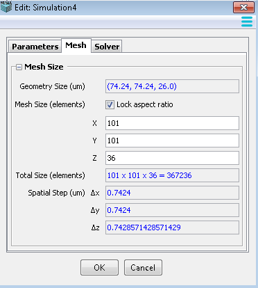
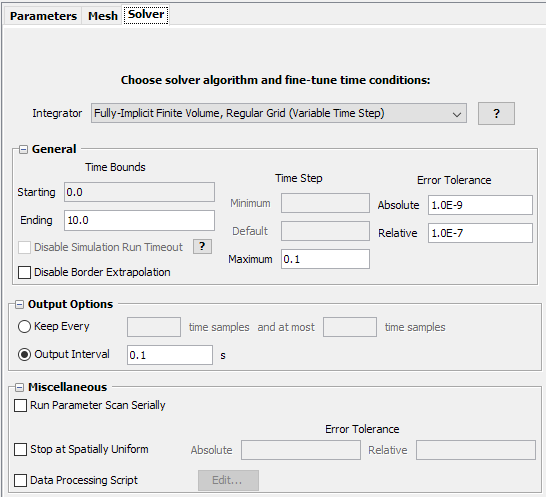
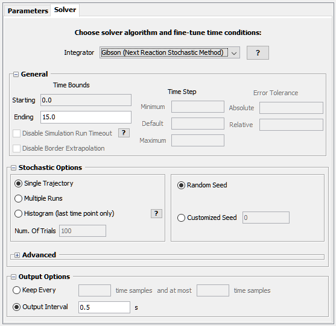
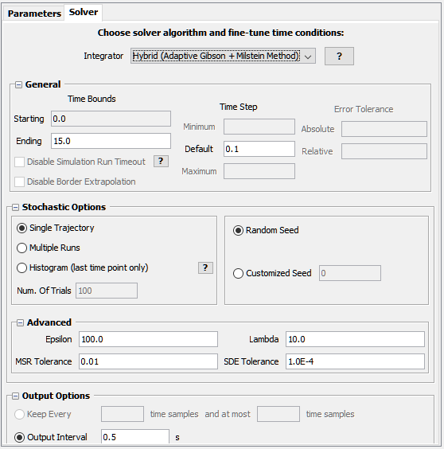
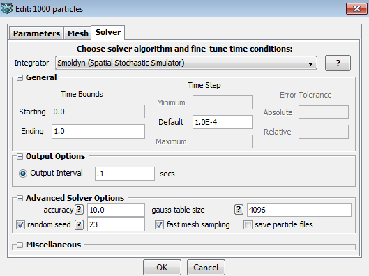

# Simulations Editor

In the "Simulation" tab, highlight the simulation you want to edit and clicking the "Edit
Simulation" button leads to you a simulation editor. The simulation editor will have 2 or 3 tabs
depending on whether the simulation is non-spatial or spatial. "Parameters" and "Solver" tabs always
appear while "Mesh" is only present for spatial simulations.

**Parameters**

Displays a summary list of the Parameters, the Default, Changed or Scanned Values used in the
simulation. VCell is able to run complex simulations in which one or more parameters vary according
to a specified list or range of possible values. Altering parameter values allows you to quickly and
easily modify your model description without having to make a complete new BioModel or access the
BioModel dialog. Parameter scans enable the user to do “brute force” exploration of the parameter
space of a model in a single simulation specification without having to manually create, edit, and
run many individual simulations that would test the different combinations of parameter values.
**Right-click menu** allows for copying and pasting parameter values.

- Change Value

- The Simulation Editor window allows the user to override the default value of any parameter by
  specifying a different value to be used during the simulation. The value can be a numerical value
  or mathematical expressions. Identify the Parameter Name and Double click on the New
  Value/Expression field to type in a new value or expression. Press Enter to accept the value. Note
  that values that have changed appear in red.

- Scan

- To specify a parameter scan, one must check the corresponding checkbox for the parameter (s), and
  a dialog box will appear where the user can enter a List or Range of values to be scanned.

  

  List- Enter values separated by commas. Each value will be used in a simulation.

  Range - Enter the values that will be used as the minimum and maximum values between which
  intermediates are calculated as equal interval values.

  Range Log - When the checkbox ‘log’ is used, the intermediate values between the minimum and
  maximum are calculated as equal ratio values - e.g. for the example shown, the four values would
  be 0.1, 1.0, 10, and 100. This allows scanning over several orders of magnitude in a progressive
  way.

  When more than one parameter is checked for scanning, the simulation will be performed with all
  possible combinations of values for all scanned parameters. The figure shows the Simulation Editor
  window for such a simulation, where 2 parameters were specified for scans, one with a list of 3
  values, and one over a range of 2 values, resulting in a total of 6 different combinations for
  which the simulation is run.

  A non-default parameter value can be specified as a free-form mathematical expression involving
  other parameters. This can be used as a powerful way of doing parameter scans. One parameter is
  scanned over a range of values, the non-default value has a mathematical expression that includes
  the scanned parameter. The non-default value will “follow” the scanned parameter and thus take
  many different values.

**Mesh** (see definition [Mesh](../../Appendix/Definitions.md#mesh))

This tab is only available in spatial models with resolved geometries. Specify Geometry size and
Mesh size for spatial models.

- Geometry Size

- Display the size of the associated geometry, in microns. Geometry size is defined in the Geometry
  Editor.

- Mesh Size

- Default size corresponds to the experimental image data size and/or any defined analytic
  geometries. The higher the number of elements (points in x and y) used to create a mesh, the finer
  the spatial resolution and greater amount of time required to compute. Coarse (lower number of
  points in x and Y) mesh sizes are suggested for initial simulations to obtain faster solutions.

  

**Solver**

This tab allows user to choose a desired solver, set time bounds, time step and error tolerance,
select output options and other miscellaneous settings. All the options/choices in this panel vary
according to the selected solver.

- Integrator

- An appropriate integrator (solver) is automatically selected by default based on model and
  geometry characteristics. Additional solvers may be available and can be chosen from the drop-down
  menu.

  

  Pressing the question button displays a description of the currently selected solver. Please
  reference the description of the Virtual Cell [numerical solvers](numerical_solvers.md).

- General (options will be displayed based on integrator (solver) type chosen)

- In the General section, user can specify,

  1\. Time Bounds --- starting time and ending time.

  2\. Time Step --- minimum, maximum and default time step.

  3\. Error Tolerance --- absolute and relative error tolerance.

  The Disable Simualtion Run Timeout allows specially authorized users to exceed the 21 day limit
  after which simulations using VCell servers are automatically terminated. Contact
  VCell_support@vcell.uchc.edu if you need to run a simulation that exceeds the time limit.

  Disable Border Extrapolation is used with the Fully-implicit Finite Volume Solver to avoid
  possible errors when steep concentration gradients occur at membranes. See the
  [numerical solvers](numerical_solvers.md) section for a discussion of when to use this option.

- Output Options

- 1\. Keep every N time samples and at most M time samples: keep every N simulation results time
  samples and the total time samples should not exceed M.

  2\. Output interval S secs: output simulation results by every S seconds.

- Miscellaneous

- 1\. Run parameter Scan Serially.

  2\. Stop at Spatial Uniform: stop the simulation when the system reaches spatial uniform based on
  the error tolerance.

  3\. Data processing script: display particle count in specified regions of interest.

- General Settings for Non-spatial Stochastic Solvers

- The following settings are applicable for all non-spatial stochastic simulations.

  1\. Random Seed: a random number generated by PC time, which is used to produce a series of
  uniformly distributed random numbers.

  2\. Customized Seed: a user specified number, which is used to produce a series of uniformly
  distributed random numbers.

  3\. Single Trajectory: a single run of the stochastic simulation with an output of trajectories.

  4\. Multiple Runs: multiple instances of the same stochastic simulation are run using a different
  random seed for each run and the results are averaged.

  5\. Number of Trails: the number of multiple trials for Monte Carlo simulation with an output of
  histograms.

  

- Special Settings for Non-spatial Hybrid Solvers

- 1\. Epsilon: minimum number of molecules, both reactant and product species, required for
  approximation as a continuous Markov process.

  2\. Lambda: minimum rate of reaction required for approximation to a continuous Markov process.

  3\. MSR Tolerance: maximum allowed effect of executing multiple slow reactions per numerical
  integration of the SDEs.

  4\. SDE Tolerance: maximum allowed value of the drift and diffusion errors(for hybrid adaptive
  method only).

  

- Settings for Spatial Stochastic Solver

- 1\. Accuracy: A parameter that determines the quantitative accuracy of the simulation, on a scale
  from 0 to 10. Low values are less accurate but run faster. Default value is 10, for maximum
  accuracy. Bimolecular reactions are only checked for pairs of reactants that are both within the
  same virtual box when accuracy is 0 to 2.99, reactants in nearest neighboring boxes are considered
  as well when accuracy is 3 to 6.99, and reactants in all types of neighboring boxes are checked
  when accuracy is 7 to 10.

  2\. Gauss table size: This sets the size of a lookup table that is used to generate Gaussian
  distributed random numbers. It needs to be an integer power of 2. The default value is 4096, which
  should be appropriate for nearly all applications.

  3\. Random Seed: a random number generated by PC time, which is used to produce a series of
  uniformly distributed random numbers.

  4\. Fast Mesh Sampling: It is used to improve performance by pre-calculating geometric quantities.
  It is selected by default.

  5\. Save Particle Files: It is an option to store particle locations to allow creating particle
  movies. Since it takes a lot of space, it is unselected by default.

  
