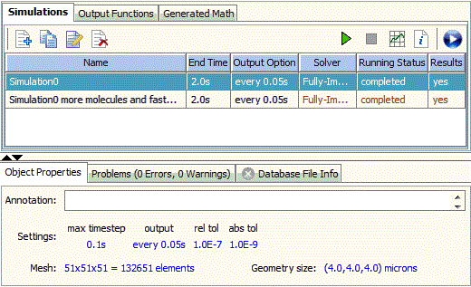
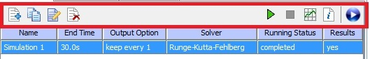

# Simulations

You can run a simulation once you have defined your physiology and created an Application in a
BioModel The model will be automatically saved upon running a simulation.

The Virtual Cell automatically converts the biological description defined in a BioModel into a
corresponding mathematical system of math equations (e.g. ordinary and/or partial differential). The
Virtual Cell will then solve the equations by applying numerical solvers to perform and analyze
simulations. Afterwards Results can be displayed and analyzed on-line or downloaded to the user’s
computer in a variety of formats.

The Virtual Cell supports 5 categories of simulations.

- Deterministic non-spatial
- Stochastic non-spatial
- Deterministic spatial
- Stochastic spatial
- Hybrid stochastic spatial

The appropriate solver will automatically be chosen when a simulation is created. Additional solver
choices may be available as dropdown menu. For more details about numerics solvers used in these
simulations, refer to [Numerical Solvers](numerical_solvers.md).

On the Simulation panel, you create, edit and run your simulations as well as view the results.
Simulations that have been created are listed in the table. In this table, one can view some of the
simulation parameters among which some can be changed in place.

- **Name:** Simulation name must be unique throughout the BioModel. In another words, different
  applications in the same BioModel can not have simulations with the same name. Double click on the
  Name field to change the name.
- **End Time:** This displays the duration of simulation in seconds.
- **Output Option:** Output Options determine how the simulation results are saved. Currently the
  Virtual Cell supports 3 output options: Keep every, Uniform and Explicit.
- **Solver:** This displays the numerical solver that has been chosen for current simulation. This
  can not be changed in the table. (see **Edit** under **Simulation ToolBar** below).
- **Running Status:** This displays status (not saved, submitted, initializing, completed, etc) and
  progress of simulation.
- **Results:** Yes, results are available OR No, results are not available

Once a simulation is selected in the table, the properties of the selected simulation is displayed
in the "Object Properties" Pane at the bottom. This provides a quick review of simulation settings.
Most parameters can be changed by editing the simulation.

- **Annotation:** Enter descriptive comments pertaining to the simulation directly in the Comments
  text field.
- **Settings:** This includes (max) time step, output option, relative tolerances, absolute
  tolerance, etc. Note different simulations and solvers have different settings. For example,
  sensitivity analysis parameter is only available for non spatial simulations.
- **Mesh/Geometry Size:** Spatial models are simulated within a geometric mesh. The mesh specifies
  the number of points used to sample the geometry. The geometry size is the domain size based on
  the geometry created or imported in the application. (see
  [Mesh](../../Appendix/Definitions.md#mesh))
- **Parameters with values changed from default:** the simulation panel allows you to modify
  parameter values in your simulation without modifying your model directly. If changes are made
  they are indicated in red in this section of the simulation summary.

**Simulation Toolbar:**

On the left are the controls that create/edit/delete the simulations. on the right are the controls
that run/stop simulations and view the results. Note most of buttons are only enabled when one or
more simulations are selected. One can edit the name of a simulation by double-clicking on the Name
field to select for editing. Pressing enter commits any edits to the simulation name.

On the left:

- **New**  Creates a new simulation.
- **Copy**  Makes a copy of selected simulation.
- **Edit**  Opens the [Simulation Editor](simulationEditor.md) with
  additional runtime features required to complete a simulation: Parameters, Mesh, and Advanced
  tabs.
- **Delete**  Deletes a selected simulation.

On the Right:

- **Run**  Starts the simulation on the remote VCell server. The
  Model (and any simulation results) will be automatically saved on the remote VCell server.
- **Stop**  Terminates the simulation.
- **Results**  Once a simulation has started and/or is complete,
  press the Results button to view the simulation results.
- **Status Details**  This shows more detailed simulation
  status, including VCell version that ran the simulation, running status (% progress, failed,
  finished), submit date, start date, end date, etc. It’s more useful when the simulation has
  parameter scans, where it will show the status of all the sub simulations.
- **Quick Run**  Starts the simulation on the user's local
  computer. The Model is not automatically saved on the remote VCell server. Data results will be
  displayed when the simulation has finished running. Results are not saved remotely and are only
  accessible while the results viewer remains open.
