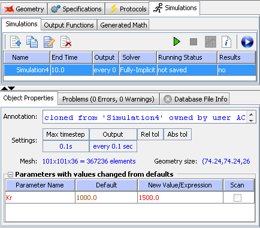
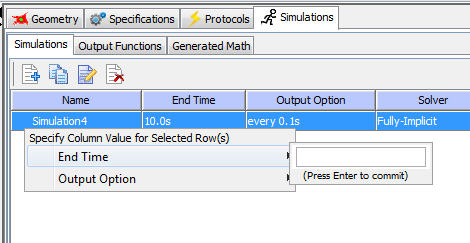

# Simulations Overview

Once a MathModel or an 'application' in a BioModel is created at least 1 simulation must be defined
to generate numerical results. You can create, copy, edit, run (local or remote), stop and delete
simulations. The simulations panel also shows the running status (% progress,results available) of
all simulations. Select a simulation row to display additional information in the properties panel
below, launch a data viewer for simulation that have been run and display parameter scan
information. Model parameters can be changed for each simulation without changing the overall model.
Simulation parameter scans can be defined to iterate over a set of model parameters, automatically
generating separate results for each combination of parameter values. The panel also contains
'Output Functions' to add user defined data expressions that are displayed when simulation results
are shown.

There are three sub-tabs under "Simulations" tab:

- Click [Simulations](simulations.md) tab to create and run a simulation.
- Click [Output Functions](output_functions.md) tab to define an output function.
- Click [Generated Math](generated_math.md) tab to view generated math.

**Right-clicking** on a simulation row will reveal a drop down submenu providing a way to edit End
Time and Output Option (frequency of saved data points).

