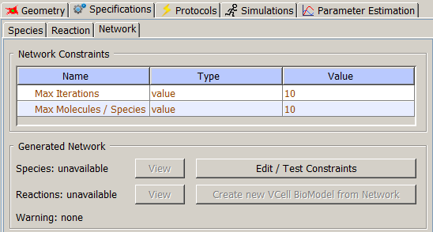
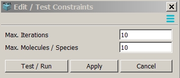
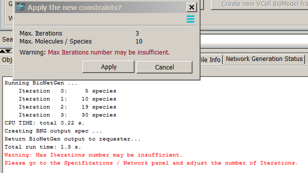
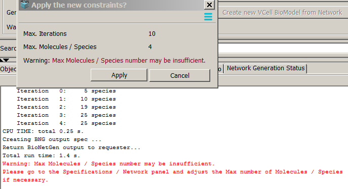
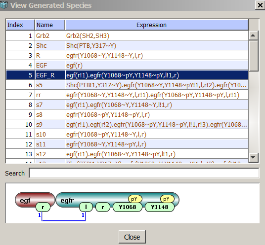

# Network Specifications

The Network Tab enables the user to specify constraints for generating a reactin network from the
rules in a rule-based model. Network-generation is performed by the
[BioNetGen](../../Appendix/Definitions.md#bionetgen) engine. The network that is generated can then
be used in [deterministic](../../Appendix/Definitions.md#deterministic) and
[stoichastic](../../Appendix/Definitions.md#stochastic) applications. In addition, the user can test
the size of the reaction network that would be obtained using the constraints supplied, prior to
actually generating the network. The network tab is active only if at least one
[Molecule](../../Physiology/Molecules.md) is specified.

- **Max Iterations** - how many times the rules are applied to the set of
  [seed species](../../Appendix/Definitions.md#seed-species) to generate new species and reactions.
- **Max Molecules/Species** - the maximal number of molecules of any type that can be in a single
  species. BioNetGen will not apply any rules to species reaching this limit.
- **Species** - the total number of species in the reaction network generated under specified
  constraints, including seed species.
- **Reactions** - the total number of reactions in the reaction network generated under specified
  constraints.

Clicking the "Edit/Test Constraints" button presents a window to specify new constraints.

- **Test/Run** to attempt to generate a reaction network using the specified constraints.
- **Apply** the constraints without generating a network; a
  [simulation](../Simulations/simulations_overview.md) will be performed sequentially after
  generating the network.

Warnings may be generated when specifying or applying the constraints:

- **Max iterations number may be insufficient** suggests that the network may be not exaustively
  generated. In this case the **Network Generation Status** pane displaying the number of species
  will show that the number of species during the last two iterations is different. Generation of
  the network is generally considered complete when the last iteration does not produce new species
  and thus the number of species at the last two iterations is the same.

  

- **Max Molecules/Species number may be not sufficient** indicates that a species with aspecified
  number of molecules is a subject of a rule applied in the last interation. This indicates that the
  network is truncated because of the limits set for the number of molecules of that species in the
  network.

  

  **Note:** When the warning is displayed, the network is truncated, so a simulation using NFSim is
  likely to produce different results compared to deterministic or stochastic simulations that use
  this network.

- Use the **Apply** button to apply the specified constraints.

- **View Generated Species/View Generated Reactions** after constraints are applied. The pop-up
  window shows the species name, depiction and searchable BNGL code. Species names are the same as
  seen "Generated Species" is checked in the "Simulation Results" window.

  

- **Create New VCell BioModel from Network** launches a new BioModel in a new window. This BioModel
  consists of all generated species and reactions, species have molecular details, while reactions
  carry rule name under reaction name.

  **Note:** reaction rates in reaction network are adjusted for
  [symmetry factors](../../Appendix/Definitions.md#symmetry-factor) and
  [statistical factors](../../Appendix/Definitions.md#statistical-factor).
