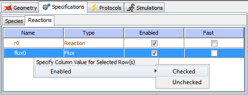
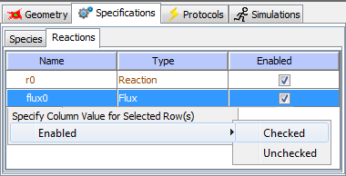

# Reactions Specifications

There is often a wide range of time scales in interrelated cellular processes that pose a problem
when computing numerical solutions. The Virtual Cell software has been designed based on the
separation of fast and slow kinetics. The user can specify the subset of reactions that have fast
kinetics and the fast system will automatically be generated and integrated into the mathematical
description by selecting or deselecting the option. This is done in the **Reactions Specifications**
panel.

**Deterministic**

**Stochastic**

**Viewing/Editing Reactions Specifications** Select a reaction from the table to display the
[Reactions Properties Pane](../../PropertiesPanes/PP_Reactions.md) in the
[Reactions Properties Pane](../../PropertiesPanes/PP_Reactions.md) (below). To edit reaction
properties, See [Reactions table](../../Physiology/ReactTabView.md). Common information includes
reaction 'Name', 'Type' (regular, flux, rule) and 'Enabled' (set/unset whether a reaction is
included in simulations).

- **Turn off reactions** in simulations by un-checking the checkbox under the **Enabled** table
  column causing solvers to ignore the reaction during simulations. A mouse popup menu can also be
  used to enable/disable a reaction.
- **Set Fast mode** for reactions in **deterministic applications** by checking the box under the
  **Fast** table column causing reaction to be treated as pseudo-steady-state. May increases the
  speed of simulation processing and reduce the time needed to run a simulation.
- **By default** all reactions are **enabled** and **not fast**.
