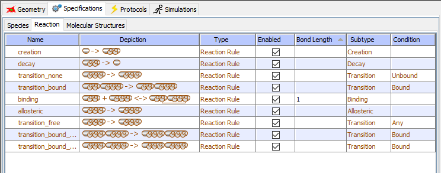

# SpringSaLaD Reactions

A SpringSaLaD reaction is an ordinary rule-based reaction rule that VCell has recognised as one of
five kinds, or subtypes. The recognition is automatic and is done by matching the rule against a
template; the result is shown on the **Specifications > Reaction** tab of a
[SpringSaLaD application](../../RuleBasedChapter/LangevinApp.md), together with anything else the
subtype needs.

When using SpringSaLaD reactions, it is important to be aware that:

- The reactions are automatically assigned to one of the predefined categories, based on template
  matching. A rule that matches nothing is reported as Not Compatible.
- The subtype belongs to the **application**, not to the rule. The same physiology can be read by a
  SpringSaLaD application and by a deterministic one at the same time.
- The **Enabled** column switches a rule off in this application only.

The SpringSaLaD reactions have the following limitations:

- The reactions are strictly categorized and must follow the template for their category.
- **Binding reactions must be reversible.** The other four subtypes must be irreversible.
- Kinetics must be mass action.

**The five subtypes.**

- **Creation** - a molecule appears out of nothing. Written with the reserved molecule **Source** on
  the left: Source() -> Molecule1(...). Zeroth order, in uM/s.
- **Decay** - a molecule disappears. Written with the reserved molecule **Sink** on the right:
  Molecule1(...) -> Sink(). First order, in 1/s.
- **Transition** - one site changes state, in 1/s, with an optional condition on whether that site
  is bound. See below.
- **Allosteric** - one site changes state because a **different site in the same molecule** is in a
  particular state. This is how a bound ligand switches on a kinase domain at the other end of a
  receptor.
- **Binding** - two sites on different molecules become sprung together, in 1/uM/s. This is the only
  subtype that carries a **Bond Length**: the length of the spring the reaction creates. It must be
  reversible - the reverse rate is how the bond breaks, which is what a dissociation reaction would
  be elsewhere.

**The transition condition, and a name to be careful with.** A Transition rule may require the
transitioning site to be bound or unbound. The condition is shown in the **Condition** column and
takes one of three values:

- **Any** - no condition. The state changes whether or not the site is bound.
- **Unbound** - the site must have no bond.
- **Bound** - the site must be bound to a named site on another molecule. A Bound transition only
  makes sense alongside a Binding reaction that can create that bond.

Readers coming from the standalone SpringSaLaD program should note that two of the three are called
something else there. Its **None**, meaning no condition at all, is VCell's **Any**; its **Free**,
meaning the site must have no bond, is VCell's **Unbound**. Only Bound is called the same thing in
both. The condition is set by how the rule is written - a bare site, a site with an explicit bond,
or a site whose bond is left unspecified - so it is read off the rule rather than chosen from a
list.

**"The forward rate Kf is too large."** This error means the model is asking for a reaction faster
than diffusion can supply, and it is worth understanding rather than working around.

The rate constant Kf you write down is the **macroscopically observable** one, and it already
contains two things happening in series: the two partners have to find each other, and then they
have to react once they have collided. Their reciprocals add, in the same way two resistances in
series do - so the observable rate can never be faster than the slower of the two steps allows, and
in particular it can never exceed the purely diffusion-limited rate, which for two spheres is set by
the sum of their radii and the sum of their diffusion coefficients.

The solver does not want Kf. It wants the **intrinsic** rate - the part that is conditional on
molecules already having collided - because collisions are something it simulates rather than
assumes. It recovers that intrinsic rate from Kf and the diffusion-limited rate. If Kf is larger
than the diffusion-limited rate, no positive intrinsic rate exists that could produce it, and the
model is asking for something physically impossible rather than merely fast.

There are two ways out, and which one is right depends on where the number came from:

- **Raise the diffusion coefficients** of the participating sites, or their radii. Both raise the
  diffusion limit, and both are worth checking anyway - a site left at the default 1 um2/s is slow
  for a small protein domain.
- **Lower Kf.** If the diffusion rates are the ones you meant, then the measured rate you started
  from was obtained under conditions the model does not reproduce, and the model's value has to come
  down.

Site radius and diffusion rate are set on the [Molecular Structures](SSSpeciesSpecifications.md)
tab, and apply per species, so a site can be faster in one seed species than another.
