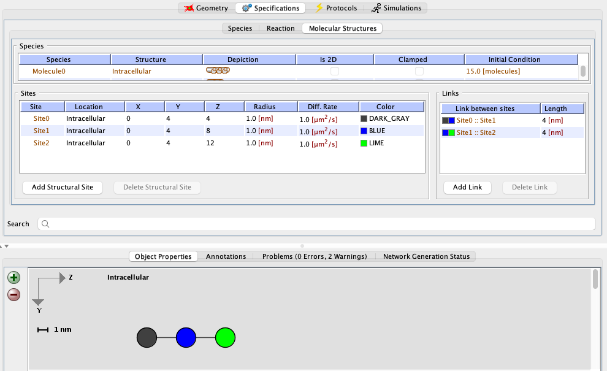

# SpringSaLaD Species

A SpringSaLaD species inherits the attributes of a rule-based species, and adds the physical
description its sites need: where each one sits inside the molecule, how big it is, how fast it
diffuses, what colour it is drawn in, and which sites are sprung together. All of it lives on the
**Specifications > Molecular Structures** tab of a
[SpringSaLaD application](../../RuleBasedChapter/LangevinApp.md).

The tab has three tables that work together. Selecting a species in the top one fills the other two.

- **Species** - one row per seed species, with its structure, its Clamped flag and its initial
  condition. The **Is 2D** column is present but fixed at false in this version.
- **Sites** - one row per site of the selected species: Location, X, Y, Z, Radius, Diff. Rate and
  Color.
- **Links** - the springs, with the length of each. Length is computed from the two positions and is
  not edited directly; move a site and the length follows.

When building a SpringSaLaD species, it is important to be aware that:

- There should be one seed species per molecule, and it is much easier to follow if they share a
  name.
- A species is placed when it is created, from the **New** button's menu - "In Compartment
  Extracellular", "In Membrane Membrane", "In Compartment Intracellular". It cannot be moved to
  another compartment afterwards.
- Every site of every species needs a radius and a diffusion rate. The defaults, 1 nm and 1 um2/s,
  are placeholders rather than recommendations.

**Membrane molecules and the Anchor site.** A molecule that lives in the membrane must have a site
called **Anchor** with the single state **Anchor**. Both names are reserved. The anchor is inert -
it takes part in no reaction and is not counted - and its only job is to hold the molecule in the
membrane.

**The order of the sites decides which side of the membrane they are on.** This is the one thing
worth reading twice. When VCell first builds the site attributes for a membrane species it walks the
molecule's site list and assigns each site a compartment by where it sits relative to the anchor:

- sites listed **before** Anchor become **Extracellular**;
- the Anchor itself is the one site on the **Membrane**;
- sites listed **after** Anchor become **Intracellular**.

It also lays them out along z in that order, 4 nm apart, and links them in a chain. So a
transmembrane receptor written as **RK(B~State0~State1,Anchor~Anchor,K~Off~On)** - outside,
membrane, inside - comes out correct with nothing left to fix: B extracellular, K intracellular, and
two springs meeting at the anchor. Written the other way round, as Anchor first, both domains land
inside the cell and every one of those has to be corrected by hand.

The convention is that **z increases from outside to inside**: an extracellular site has a smaller z
than the anchor, an intracellular site a larger one. The standalone SpringSaLaD program uses the
same convention, and its tutorial states it as putting the extracellular domain "5 nm less than the
z-coordinate of the anchor site" and the intracellular one 5 nm more.

These coordinates describe positions **inside the molecule**, not positions in the simulation box.
They are not on the same scale or in the same frame as the Intracellular expression on the geometry,
and there is nothing to reconcile between the two: the solver is told both a site's compartment and
its offset within its molecule, and places the molecule accordingly.

**Setting a site's attributes.** Select the species, then edit its row in the Sites table. Location,
Radius, Diff. Rate and Color are chosen from lists; X, Y and Z are typed in nm.

**Choose colours that survive a black background.** The
[3D Trajectory viewer](../../RuleBasedChapter/SSResults.md) draws on black, so a dark colour is a
site that cannot be seen. This is worth attending to for the reserved Anchor site in particular,
whose default is DARK_GRAY - visible enough in the tables and the molecule diagram, and nearly
invisible in the viewer. Light colours - WHITE, CYAN, YELLOW, ORANGE, LIME, GREEN - all read well.

**Links.** Sites are sprung together in a chain by default, in the order they are listed. To build
any other shape, use **Add Link** to pick two sites, and **Delete Link** to remove one that is
selected. A star - every domain linked to a central anchor - and a chain look the same in a small
molecule and behave very differently in a large one.

**Initial conditions.** On the **Specifications > Species** tab, choose **Number of Particles**
rather than Concentration if you want to state a count. SpringSaLaD simulates individual molecules,
so a count is usually what is meant, and the units in the table change with the choice.
