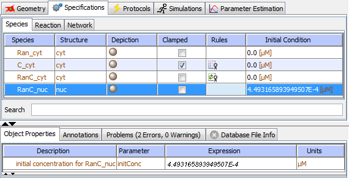
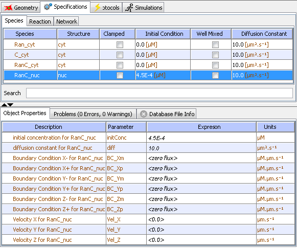
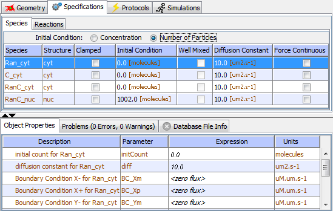
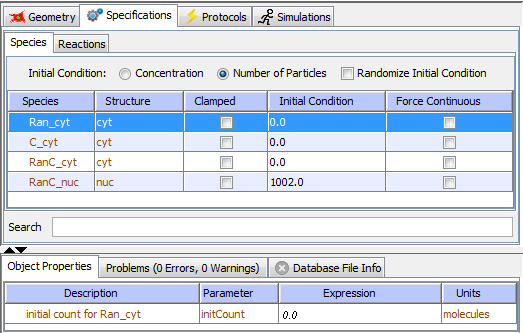
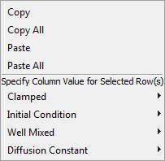

# Species Specifications

For any application, the species initial conditions need to be set. In addition, other parameters
like diffusion constant, boundary conditions and velocity terms for species need to be specified for
spatial applications. This is done in the **Specifications** tab of an **Application**.

**Non-Spatial Deterministic**

**Spatial Deterministic**

**Spatial Stochastic**

**Non-Spatial Stochastic**

Columns values for a selected species row can be changed with the mouse pop-up menu. Initial
condition expressions and values can be copied/pasted using the mouse pop-up menu.

**Viewing/Editing Species Specifications**

- **Sort** rows by values under a particular column by clicking the column 'header' (column names at
  the top of the table).
- **Select** a species from the table to display the 'Species Properties Pane' in the
  [Properties panel](../../Introduction/GeneralNavAndWinSetup.md) below the table.
- **Edit Initial Condition** by selecting a 'Species' table row and entering an expression in one of
  3 ways. (1) double-click the 'Initial Condition' table-cell in the 'Species' table. (2) pop-up
  menu over 'Species' table and select 'Initial Condition'. (3) In the 'species properties' panel
  (below the 'Species' table) select the 'initConc' or 'initCount' parameter row and double-click
  the 'Expression' table-cell. The expression can refer to other application parameters (press space
  for pop-up list). In spatial applications an expression may be used to restrict the initial
  condition to a certain region within the application geometry domain by referring to axes (x, y or
  z) within the expression (e.g. (1000.0 \* (y>= 0.89))). [Field Data](../fieldData.md) can also be
  used to import 'image' based spatially distributed 'initial conditions'.
- **Convert Concentration/Counts** of 'Initial Conditions' for **Stochastic** applications (see
  [Application Overview](../ApplicationOverview.md)) by selecting the **Concentration** or **Number
  of Particles** radio button.
- **Edit Diffusion Expression** (for spatial application) by selecting a 'Species' table row and
  entering an expression in one of 3 ways. (1) double-click the 'Diffusion Constant' table-cell in
  the 'Species' table. (2) pop-up menu over 'Species' table and select 'Diffusion Constant'. (3) In
  the 'species properties' panel (below the 'Species' table) select the 'diff' parameter row and
  double-click the 'Expression' table-cell. The diffusion expression can refer to other application
  parameters (press cntrl for pop-up list) and spatial axes x,y,z (e.g (10.0\*(y>4.0)) where the
  value 10 is confined within the area defined by the y coordinates). In addition, The diffusion
  expression can refer to time (e.g. ((t>2.5)\*3)) where diffusion would be 3 after simulation time
  2.5).
- **Clamp Concentration** by selecting a 'Species' table row and clicking the check-box under the
  'Clamped' column. The concentration of the selected species remains constant for all simulation
  times and does not diffuse. The species in this case is no longer a variable but instead becomes a
  parameter and the diffusion constant is disabled. Known concentrations may be held constant in a
  reaction in order to aid in determining unknown concentrations of other species elements.
- **Set Boundary Conditions** (for spatial applications) by selecting a 'Species' table row then
  selecting a 'Species Properties' table row for a 'Description' column item that starts with
  'Boundary Condition...'. The **type** of 'Boundary Condition' is set in
  [Structure Mapping](../Geometry/geom_spatial_mapping.md). The default 'Boundary Condition' for a
  given species at each boundary (X-,X+, Y-,Y+, Z-,Z+) is fixed at either zero, when using **Flux
  type**, or the concentration set in the Initial Condition field, when using **Value type**. Each
  'Boundary Condition' can be assigned an expression of flux ('Flux type') or a clamped
  concentration different from that entered in the Initial Conditions field ('Value type').
- **Set Velocities for Directed Transport** (2D or 3D spatial applications) by selecting a 'Species'
  table row then selecting a 'Species Properties' table row for a 'Description' column item that
  starts with 'Velocity...'. The velocities provided by the user are used to calculate the
  velocities of the species at any location within the model. Velocities can be provided as constant
  values or as a function of spatial coordinates, x,y,z as well as time.
- **Set Randomized Initial Condition** (non-spatial stochastic applications, see 'Non-Spatial
  Stochastic' figure above) by clicking the 'Randomize Initial Condition' check-box. The solver will
  select an initial condition value from a Poisson distribution with the user defined initial
  condition as the mean of the Poisson distribution.
- **Set Force Continuous** (for stochastic applications) by selecting a 'Species' table row and
  clicking the 'Force Continuous' column (spatial stochastic) check-box. The checked species will be
  treated by the solver as determistic (continuous) variables. Stochastic applications with 1 or
  more 'Force Continuous' check-boxes set are considered to be
  [Hybrid Deterministic Stochastic](../ApplicationOverview.md).
- **Rules** (for non-spatial deterministic applications, view only) Indicates if a
  [rate rule](../Protocols/RateRules.md) or an [assignment rule](../Protocols/AssignmentRules.md) is
  associated to the species (variable).
