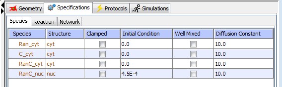

# Specifications Overview

Once a biological model has been defined in the physiology view, an
[Application](../ApplicationOverview.md) in the Virtual Cell software is used to set up a virtual
experiment. Setting up an application includes deciding the type of mathematical model
(deterministic or stochastic) to be created, mapping relationships between the physiological
objects, their values and geometries, and setting initial conditions for the species and reactions.
The **Specifications** item in an 'Application' involves setting initial conditions for species and
reactions for that particular virtual experiment.

**Specifications** can be accessed by clicking the **Specifications** item under any **Application**
in the 'Navigation' panel tree structure. This selects the **Specifications** tab for the
application in the 'View' panel on the right. The 'Specifications' tab has the following 3 sub-tabs:

- [Species Specifications](SpeciesSpecifications.md)
- [Reactions Specifications](ReactionsSpecifications.md)
- [Network Specifications](NetworkSpecifications.md) (for deterministic and stochastic applications)
  or [Network-Free Specifications](NetworkFreeSpecifications.md) (for network-free application)
