# Field Data - Using experimental or simulation data as initial conditions

In VCell, the initial conditions for spatial simulations can be defined as a uniform value,
analytically as a function of spatial coordinates, or based on spatially varying results from an
experiment (e.g. fluorescence imaging data) or from a simluation. The **Field Data** Manager allows
initial conditions to be defined using irregular spatial distributions of molecular species observed
in image data. **Field Data** can also be applied to cases where the output of one spatial
simulation (e.g. a simulation to determine steady-state distributions of molecular species) serves
as the initial condition for another simulation (e.g. after a specific stimulus event). A **Field
Data** object can contain more than one variable (set of data values) and be defined over multiple
time points. Each variable at a selected time point is represented as a **Field Data** function that
behaves as any other mathematical function (e.g. square root, sine, etc...) when evaluated within a
VCell simulation. The function essentially acts as a lookup table mapping values from an (x, y, z)
rectangular data grid in the Field Data Object to an (x, y, z) location in the mesh of a spatial
simulation. It is essential that the geometry for the image or simulation result is identical to the
geometry used for the simulation.

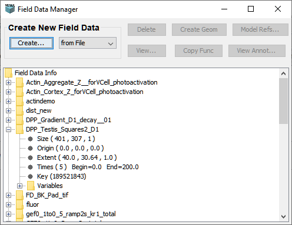

The Field Data Manager is opened from within the top level **File**menu in the main VCell workspace.
The Field Data Manager display provides an overview of current Field Data Objects owned by a VCell
user and includes tools for creating, accessing and using the Field Data Objects. The main window of
the Manager display contains a tree view of all Field Data objects created by the user. Additional
information includes the following items:

- Size: number of elements in the Field Data Object for each spatial dimension (x, y, z)
- Origin: position (x, y, z) of the upper, left, bottom corner in simulation domain space (by
  default this is assigned (0,0,0) unless reassigned by the user when creating the Field Data)
- Extent: size (x, y, z) in the simulation domain space occupied by the Field Data Object data grid
- Times: the time domain associated with each separate data grid defined in the Field Data Object
- Variables: individually defined data sets within the Field Data Object (all sharing the same Size,
  Origin, Extent and Time information).

**Open** the "Variables" folder to display a list of the names and type (volume, membrane) of
variables contained within the parent Field Data Object.

**Create a Field data Object.**

New field data can be created from either a simulation result or a file by selecting either "from
simulation" or "from file" in the Create New Field Data drop down box and then clicking "Create"

**Create... from Simulation Result** opens a table of VCell spatial simulations from all models
currently open in the VCell client. Select a row from the table and select "OK"; A dialog box
displays the "FieldData Info".

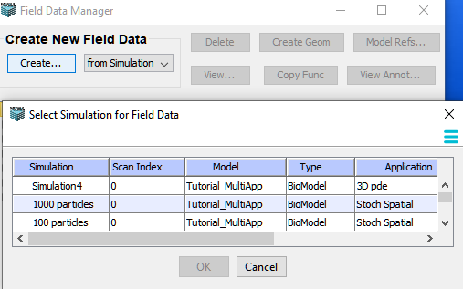

Enter a name for the field. All of the variables will be included in the Field Data, regardless of
the selection in the Variable names box. The rest of the information (Times, Origin and Size) is
predefined by the simulation data information and cannot be edited. The **Field Data Annotation**
box accepts typed annotations.

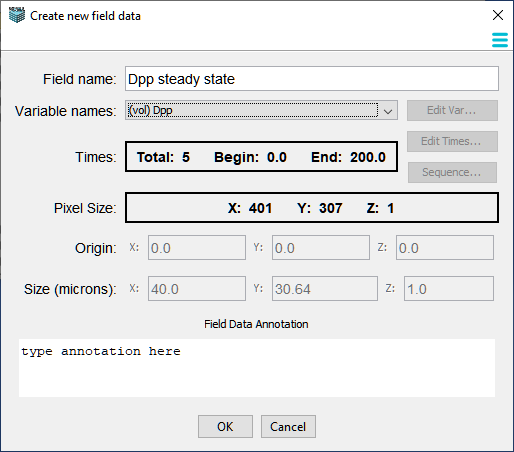

**Create...from File** allows you to create field data from external files such as microscope image
data files or data generated with a program such at MATLAB or MathCAD. VCell can open any format
included in the Bioformats library. Opening a file opens the Create Field Data dialog box.

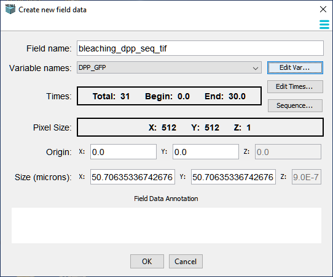

By default the Field name is the filename, but can be changed to any unique Field Data object name.
Note that the image used for field data must ultimately match exactly the geometry in the VCell
Application where the field data will be used.

- **Select the appropriate image channel** from the Variable names drop down box.
- **Edit the variable name** by selecting the "Edit Var..." button.
- **Edit time values** for a time sequences using the "Edit Times..." button to individually assign
  time values or using the "Sequence" button to assign a uniform step. All time steps will be
  included with the field data object.
- **Edit origin coordinates** for the image to match exactly the geometry in the VCell BioModel
  Application where the field data will be used.

**Use Field Data in an Application**

Use field data for initial conditions in an application by opening the Field Data Manager from
within the top level **File**menu in the main VCell workspace. Open the Field Data Object you will
use, select an appropriate variable and click the **Copy Func** button in the top menu. If there are
multiple times (e.g. if the field data was created from a simulation result), a dialog box opens
allowing you to select an appropriate time. Select a time value and the "OK" button. A function with
a specific syntax is copied to the clipboard that can be pasted as the initial condition for a
variable in either a BioModel or MathModel

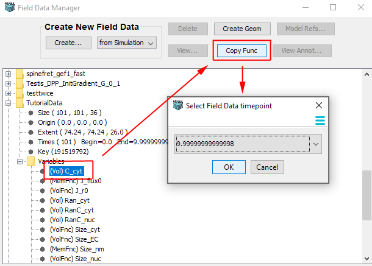

**Insert as initial condition** for a variable using the Specifications tab of a BioModel
Application. Paste the function in the "Initial Condition" cell in the table or in the Properties
Pane using control v (Windows) or command v (Mac). In the MathModel workspace, this function is
simply pasted to the list of functions in the VCML Editor window. When a simulation is run using
field data as initial conditions, when the Field Data function is called the values from the Field
Data Object are mapped onto the simulation geometry. if the simulation mesh size is the same as the
Field Data size no interpolation will be necessary. If the Field Data spatial domain is different
from the simulation mesh, interpolated values are computed.

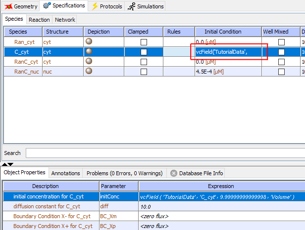

**Other actions from within the Field Manager**

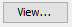

**View Field Data** displays field data in a VCell simulation results viewer window when the top
level folder for a field data object is selected.

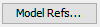

**Find** all applications that use a particular field data object as initial conditions. A table
will show all BioModels that use the Field Data Object.

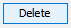

**Delete** Field data objects. Field data objects can only be deleted if they are not used in any
VCell model simulations.

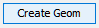

**Create new geometries** from field data by selecting a specific variable (or channel) within a
Field Data Object. The VCell Geometry Editor will appear preloaded with an image representing values
from the selected Field Data variable.

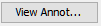

**Add text annotations** to the field data object.

**Field Data Syntax**

The syntax of the Field data function is described as follows. For a Field Data Object with the
Field Data name 'fdata_gif' and containing a volume variable named "Channel0" with multiple x, y, z
data grids defined for times 0.0 to 5.0 at intervals of .5 seconds, a VCell function created from
the spatial data at time 3.5 would be defined as "vcField(' fdata_gif','Channel0',3.5,'Volume')".
The word "vcField (...)" in the function text is the built-in VCell function name for Field Data and
the information within the parentheses (Field Data name, variable name, time point, variable type)
tells the VCell where on the VCell server the Field Data information is located.
