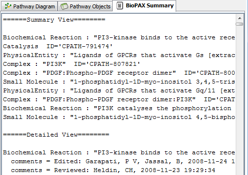

# BioPAX Summary

Displays the pathway entities from the [Pathway Diagram](../PathwayDiagram/PathwayDiagramView.md) in
text format.

The view has 2 sections. The Summary View is displayed first, followed by the Detailed View. The
Summary View shows the list of entities present in the Pathway Diagram using the general format of
Type, Name, ID.

The Detailed View shows, for each and every entity, the equivalent of the
[Entity Properties Pane](../../PropertiesPanes/PP_Pathways.md) in text format and with each inner
sub-entity expanded.

All the information in this view is read-only.
