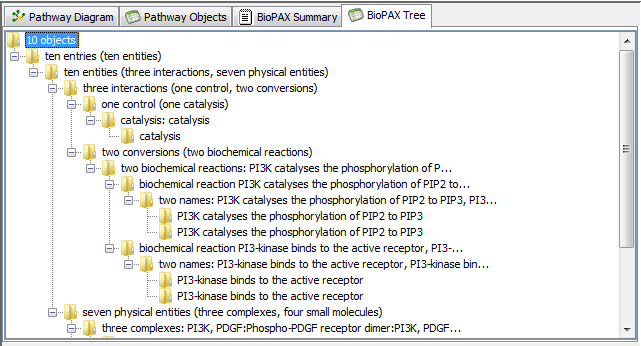

# BioPAX Tree

Displays the pathway entities within the [Pathway Diagram](../PathwayDiagram/PathwayDiagramView.md).
All the information in this view is read-only.

The view is presenting the data using a tree format.

