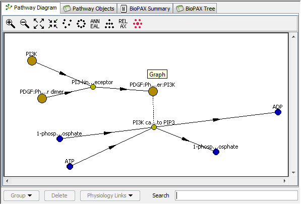
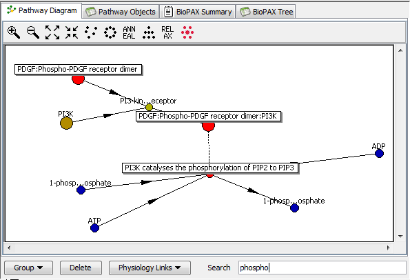

# Pathway Diagram View

Displays in a graphical form the entities imported by the user from the
[Pathway Preview](../PathwayImportTable.md) panel. It can be used to examine their properties,
import entities into physiology and manage their linking to species and reactions in Physiology.

**Pathway Diagram** represents graphically objects from the
[Pathway Objects](../PathwayObjects/PathwayObjectsView.md) panel.

Various physical entities and interactions are shown as circles of different colors (brown for
complexes, blue for small molecules, green for proteins and others). The relationships between
entities are shown as full lines (for biochemical reactions) or dotted lines 9for catalysis and
control). Entity names are shortened. Mouse over entity gives the full entity name.

Selecting a single entity activates the bottom
[Entity Properties](../../PropertiesPanes/PP_Pathways.md) pane that shows the properties of a
selected entity.

More entities can be added from the [Pathway Preview](../PathwayImportTable.md).

Selecting multiple entities activates [Group](../../PropertiesPanes/GroupOperationsPanel.md) button.

Selected entities can be imported into the BioModel and be either created new or linked to existing
species and reactions in Physiology using
[Physiology Links](../../PropertiesPanes/GroupOperationsPanel.md) button. The same functionality can
be accessed as well by mouse right click an entity in the diagram view.

To simplify operations, the items in the diagram can be filtered in real time by typing a string
inside the **Search** field. All the matching entities will show up in the diagram as selected
(marked in red).

