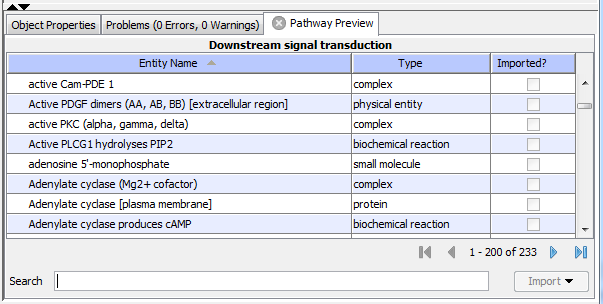
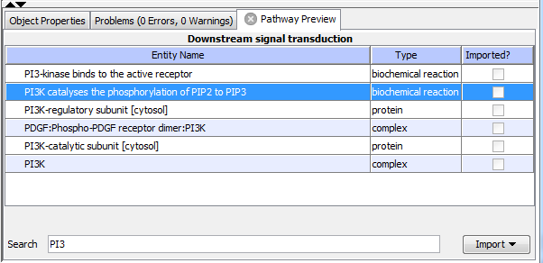

# Pathway Preview

After pressing **Preview** button or **double clicking** the pathway the **Pathway Preview** table
shows the interactions (i.e. biochemical reaction, transport, transport with biochemical reaction)
and the physical entities (i.e. proteins, small molecules, complexes, DNA, RNA) it contains.

The **Pathway Preview** shows all entities from a pathway that can be added to the pathway model. It
has three columns: the first contains an entity name, the second the (BioPAx Level 2) type of
entity, and the third shows whether this entity is already imported into the VCell. At the bottom,
there is a search text field to filter results and an add button to add selected entities to the
pathway model.

Clicking on table headers **Entity Name** or **Type** will sort entries in alphanumeric order.
**Search** allows the user to search for text in the table based on the search string entered by the
user. The table is filtered to display those entities that match the given search string. To select
an entity, click on its raw. To select multiple entities, use Shift and Ctrl buttons as in Excel.
Checked checkboxes in **Imported?** column show entities that are already added to the pathway
model.

After entities have been selected, pressing the **Import** button import these entities and all
relevant database information and will add them to the pathway model. There are several options for
import:

- **Selected only** will import selected entities only, with required dependencies (selected
  interaction will be imported with all participants).
- **Plus interactions** will import selected entities plus all interactions these entities
  participate
- **Plus components** will import selected entities plus all their components and their
  interactions, e.g. if the selected entity is a complex
- **Plus complexes** will import selected entities plus all complexes the entity is a part of.

The pathway model entities are being displayed in multiple formats. To perform operations as a
[Pathway Diagram](PathwayDiagram/PathwayDiagramView.md), as a list of
[Pathway Objects](PathwayObjects/PathwayObjectsView.md), as
[BioPAX Summary](PathwayObjects/PathwayObjectsView.md) or as
[BioPAX tree](PathwayObjects/PathwayObjectsView.md)
