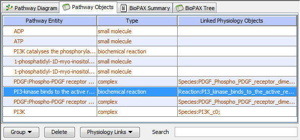
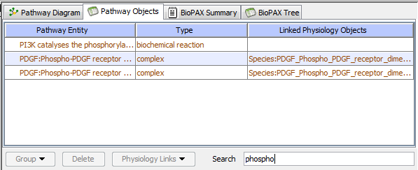

# Pathway Objects Table View

A table of pathway entities can be used to examine their properties and their linkage to Physiology.
It is the table format representation of the
[Pathway Diagram View](../PathwayDiagram/PathwayDiagramView.md).

The table view shows the pathway entities, their type and linked objects within the physiology. For
example, the selected reaction and its participants are already linked to reaction and species in
physiology.

For every selected object in the top view the bottom pane of the window displays
[Object Properties](../../PropertiesPanes/PP_Pathways.md), such as name, linked physiolofy objects,
reaction participants for reaction, clickable links to original databases and publications, comments
etc.

The user can perform various operations upon these entities, either on individually selected
entities or multiple selected entities using the
[Entities Management Toolbar](../../PropertiesPanes/GroupOperationsPanel.md). Clicking on
[Physiology Links](../../Physiology/PathLink.md) button will either show linked physiology objects
for selected pathway entities, or allow editing them, or establish new links.

The table items can be sorted alphabetically by any column by clicking on the column header. As an
added capability, the items in the table can be filtered in real time by typing a string inside the
Search field.

