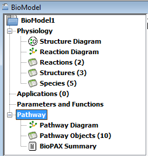

# Biological Pathways Overview

Cascading biochemical reactions occurring within a cell and carried out in a specific sequence are
called a biochemical pathway. Numerous distinct pathways co-exist within a cell and they are quite
elaborate because of the many participants involved.

We are providing a way of bringing the wealth of information contained in major pathway databases
into your model - as a way to speed up the process of building a biomodel and, more important, as a
way of annotating vCell entities.

The process begins with a [keyword search](../DatabaseSources/PathwayCommonsPanel.md) in the Pathway
Commons Database, from **Pathway Lookup** under **Pathway** in the Navigation Panel - which will
result in a list of pathways.

The chosen pathway can be [imported in a table](PathwayImportTable.md) which will display the
entities (interactions and physical entities) it consists of.

Furthermore the user can choose the entities of interest and add them to a collection whose content
can be displayed as a [diagram](PathwayDiagram/PathwayDiagramView.md) or in a
[tabular format](PathwayObjects/PathwayObjectsView.md). Detailed information about each entity is at
this point available.

As a last step, the user can choose which entities will be made part of the biomodel through a
[linking process](../PropertiesPanes/GroupOperationsPanel.md).

While working on other topics, click at any time on the Pathway tree item or on its children in the
[Navigation Panel](../Introduction/GeneralNavAndWinSetup.md) to return to displaying pathway
entities.

