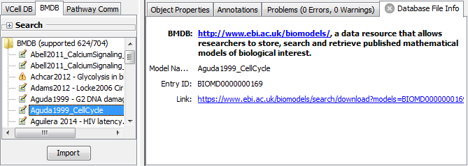

# BioModels Database

[BioModels Database](http://www.ebi.ac.uk/biomodels/) is a data resource that allows researchers to
store, search and retrieve published mathematical models of biological interest. The database
contains a list of curated models stored in SBML (Systems Biology Markup Language) format, and that
can be converted to and from a set of limited representative formats.

The models that are incompatible with the Virtual Cell are marked with an exclamation icon. The most
likely reasons are inconsistent unit systems and non-integer stoichiometry.

- **Search textfield:** Enter text fragment used to search model names and meta-information for
  matches.
- **Search button:** Press to begin search using the text fragment entered in search textfield.
- **Show All button:** Press to clear search and show all available models.
- **Model Names list:** Displays available models from repository matching search criteria. The
  selected model will be downloaded from the repository when the Import button is pressed.
- **Import button:** Starts process to download the selected model from the repository, convert the
  file to VCell format and open a new BioModel document window containing the imported model.
