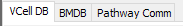

# Database Sources

The Virtual Cell provides access to repositories of compatible biological models, internal and
external. The internal VCell database repository stores the models created in the Virtual Cell in
its native format. The external repositories are accessed through specific interfaces and allow
users to search for models of interest and import selected models into a VCell MathModel or
BioModel.

Model repositories accessible through VCell are browsed from the **Welcome window** (**File >
Welcome Window**); pathways from Pathway Commons are searched from the **Pathway Lookup** tab of a
BioModel's Pathway Tools window (**Tools > Pathway Tools...**):

- [VCell database (internal)](VCellDatabase.md)
- ['BioModels Database' repository (external)](BioModelsNet.md)
- [Pathway Commons repository (external)](PathwayCommonsPanel.md)

For more information about the external model repositories visit their respective web sites:

- BioModels Database (https://www.ebi.ac.uk/biomodels-main/)
- Pathway Commons (https://www.pathwaycommons.org/pc/)
- SabioRK (https://sabio.h-its.org/)
