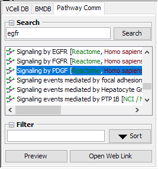

# Pathway Commons Database

The **Pathway Commons** panel allows to query and download biological pathways from Pathway Commons
in BioPAX Level 2. Pathway Commons aggregates and integrates the content of nine major pathway
databases (BioGRID, MSKCC Cancer Cell Map, Human Protein Database, HumanCyc, SBCNY IMID, IntAct,
MINT, NCI/Nature PID, Reactome). As of October 2011, Pathway Commons contains 1,668 pathways,
442,182 interactions, 86,282 physical entities and 414 organisms. Downloaded pathways can be used to
build and annotate models based on the pathways and their links to terminologies and databases about
proteins, small molecules, genes, anatomical features, organisms and publications.

To open it, select **Pathway Lookup** under **Pathway** in the tree at the **upper left** of a
BioModel window; it is also the **Pathway Lookup** tab beside the Pathway Diagram. A previewed
pathway opens in the **Pathway Preview** tab at the lower right, from which it can be imported into
the model.

- **Search textfield** Enter 1 or more space separated text fragments that will be used to match
  model names and meta-data information in the Pathway Commons repository.
- **Search button** Search the Pathway Commons repository using the search text.
- **Search list** Displays downloadable pathway names (with source and organism name) matching
  search criteria. select 1 entry from the list to be downloaded from the remote repository.
- **Filter textfield** Enter text to match name, database or organism in the current 'Search list'
  to refine search results.
- **Filter Sort button** Press to toggle sort of the current 'Search list' by pathway names in
  ascending or descending order.
- **Preview button** Press to download the pathway information selected in the 'Search list'. Once
  the download is complete a table of pathway subcomponents is displayed under the **Pathway Preview
  tab** in the lower right panel of the VCell document window. See
  [Pathway Preview](../BiologicalPathways/PathwayImportTable.md) for information about importing
  pathway subcomponents into VCell.
- **Open Web Link button** Press to launch a web browser that displays the Pathway Commons web page
  of the pathway currently selected in the 'Search list'.
