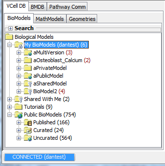
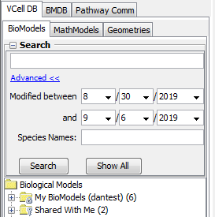
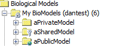
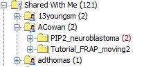
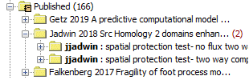
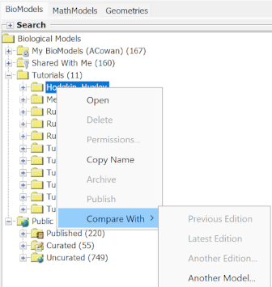

# VCell Database

The Virtual Cell Database repository stores all the models created using the Virtual Cell software.
The current user has access to the models created by him/her, models that are shared with the
current user by other VCell users and those that are public.

The Virtual Cell Database is browsed from the [Model Explorer](ModelExplorer.md) (**File > Model
Explorer...**), whose tree has the folders described below, and from the **VCell Database** tab of
the **Welcome window** (**File > Welcome Window**). Document windows no longer have a database panel
of their own, so parts of the description below, written for that panel, may differ from what these
windows show.

Right-click a model in the Welcome window's **Recent Models** or **VCell Database** lists (or select
it and press **Shift+F10**), or in the Model Explorer's tree, for its menu:

- **Open**, and **Export / Save to File...** without opening it.
- **Show in Model Explorer** (in the Welcome window), which opens the Model Explorer with that model
  selected.
- **Compare With** its previous or latest edition, another edition, or another model. **Another
  Model...** opens the [Model Explorer](ModelExplorer.md) at the model, to pick the one to compare it
  with there.
- **Copy Name**, and **Copy BioModel ID Number** (or MathModel), which copies just the number in its
  ID, such as 233648465 for biomodel-233648465.
- For your own models: **Permissions...**, **Archive**, **Publish** and **Delete...** (which asks
  first). Items that don't apply to a model are greyed out, and their tooltip says why.

Choosing this tab displays another set of 3 tabs - **BioModels**, **MathModels**, and **Geometry**
that display the accessible models of that document type.

The **VCell DB** tab has a **Search** section that allows the user to search for models by name (and
annotations). Under **Advanced** searches can also include date modified and models that contain 1
or more species names.

The models are listed in a tree structure as 'folders'. A "key" icon by the folder indicates that
the models is shared with other users. a "globe" icon indicates a model that has been made public.
The number of models stored in the database under each 'folder' is displayed in parenthesis.

The possible folders that are listed include:

- **My BioModels** - where the current user's models are listed with user name in parenthesis. The
  "lock" icon indicates these models are private to the user unless otherwise indicated. The example
  below shows a private model, one that was shared with another user and one that was marked as
  public.

  

- **Shared With Me** - where models shared by other users with current user are grouped by user name
  and listed as model name.

  

- **Tutorials** - list models that are designed to demonstrate specific components of VCell, such as
  FRAP (for spatial simulations), or Multiple Applications of a BioModel (MultiApp). These models
  can be used as starting models for modelers seeking to model similar problems.

- **Public BioModels** - list all VCell models available to the general public.

**Public BioModels** - list all VCell models available to the general public.

- The **Published** folder contains public Models created by users and used in a publications.
  Models are grouped by the publication citation and listed by user name and model name.

  

- The **Curated** folder contains VCell models created by the VCell team or collaborators to
  reproduce a model described in a publication. Curated models are listed by user name : model name

- The **Uncurated** folder contains public Models created by users that have not been peer reviewed.

Expanding a tree node displays all the models of relevant type. Each model, when expanded, will list
all the versions/editions of the models stored. Selecting any model or one of its versions lists a
summary of the model (Associated Citations, Model Provenance, and Applications Provenance including
Geometries and Simulations) in the **Selected BioModel Summary** in the
[Database File Info](../PropertiesPanes/PP_VCellDatabaseInfo.md) Properties Pane in the lower right
of the window.

Right clicking any selected model brings up a pop-up menu.

The options available are:

- **Open** - opens the selected model. Please refer to the section
  [File ->Open](../Introduction/Open.md).

- **Delete** - allows user to delete the selected models (only the current user's models). To access
  the delete function, the user should make sure the document he/she is interested in deleting is
  closed prior to deleting it. A warning message is displayed asking if user wants to continue with
  the delete operation.

- **Permissions...** - allows user to share his/her models with other users. Please refer to the
  section [File -> Permissions](../Introduction/Permissions.md).

- **Archive** - this option is designed for use when models are used in publications or need to be
  saved in a final state. An Archived BioModel or MathModel is protected from deletion or alteration
  by the owner.

  A description of the restrictions imposed on Archived documents is displayed. The current Archive
  restrictions: ARCHIVING cannot be undone without VCELL administrative assistance. ARCHIVED
  versions of documents cannot be deleted without VCELL administrative assistance. Press **OK** to
  set 'ARCHIVE' mode. Models can always be made public using
  [Permissions](../Introduction/Permissions.md) without archiving, and archived models can have
  permissions set to either 'Private' or 'Public''. Models with results reported in publications
  should be made available to the public; see DocumentWindow->Help->'How to Publish a Model' for
  information on how to report publication information. Once information of the publication and the
  public model are provided to the Virtual Cell team, the model will be added to the "Published
  Models" folder and the model will be automatically archived. If the users wishes to continue
  developing the model, it can be copied into a new BioModel or MathModel name in the user's private
  model folder. The model and citation will also be listed on the VCell “Published Models” web page.

- **Publish** - Convenience link (same as DocumentWindow->Help->'How to Publish a Model') on how to
  identify a VCell model in a publication and how to associate a model with publication information
  in the VCell Database.

- **Compare With Saved** - allows user to compare models. In the dialog that appears, the user can
  select the model he/she wishes to compare against the selected baseline model and press the
  **Open** button. Please refer to the section
  [Compare With Saved](../Introduction/CompareWithSaved.md).

Selecting a model of any document type in the VCell Database displays the database information for
the model in the **Database File Info** tab in the 'Properties' panel on the lower right hand corner
of any VCell document. See [Database Info](../PropertiesPanes/PP_VCellDatabaseInfo.md) for more
information.
