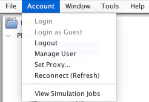

# Account

The **Account** menu bar option allows the user to change the login status the current user of
VCell, and to manage account settings using the VCell Auth0 app.

- **Login** directs the user to the [VCell Auth0 Profile page](Auth0ProfilePage.md) to login to
  VCell if they are not currently logged in.
- **Login as Guest** allows user to login as a "guest" if they are not logged in already. Guest
  login can only access public models and cannot be used to save a model to the database.
- **Logout** allows user to logout if they are logged in. The user will be directed to the VCell
  Auth0 site to complete the logout. Once logged out the user can only use VCell in an offline mode,
  with no connection to the VCell database or servers.
- [Manage User](Auth0ProfilePage.md) - takes the user to their Auth0 profile web page to manage
  VCell credentials.
- [Set Proxy...](SetProxy.md) - allows the user to set a Proxy if local policy prevents direct
  connection to the VCell server.
- **Reconnect (Refresh)** - allows user to reconnect to the server. The status bar displays the
  connecting status.
- [View Simulation Jobs](ViewSimStatus.md) provides a way to view and currently running, stopped or
  failed simulation jobs and to stop any jobs currently running.
