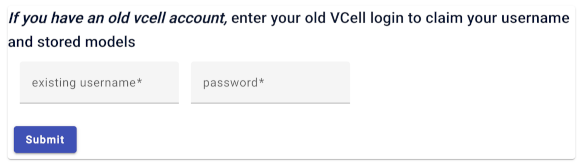
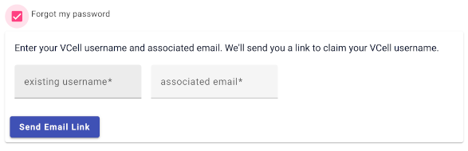
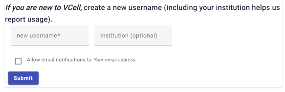
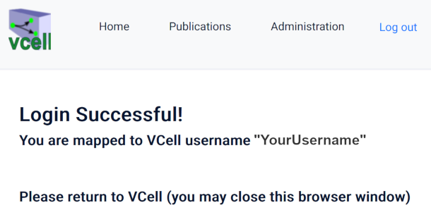

# Auth0 Profile Page

When **Login** is selected at first use, the user is redirected to the **AuthO Profile** page to
create a user profile and complete creating an Auth0 account. A VCell username is required to access
all the functionality of VCell. The VCell username will then be mapped to an Auth0 login account.

**Existing Users** need to provide the username and password of their existing VCell account.

**Select Forgot my password** if you have forgotten your password. Provide the username and
associated email of the account and an email will be sent with a link that will immediately approve
linking the VCell account to an Auth0 account. If you do not remember both old username and email,
contact VCell Support

**New VCell Users** need to create a username and provide a valid email address. VCell usernames are
case-sensitive. Click the checkbox at the bottom of the registration dialog if you wish to decline
receiving VCell notification emails.

Once a unique VCell Username is applied, a new Auth0 account is created and you are directed to a
Success Auth0 profile page. Simply close the page and return to VCell. A message saying Failed to
map new user, please try again will appear if the username provided is already in use. Pick a new
one and try again.

